[← Database ER diagrams](README.md)

# Appointments service

Keeps its own denormalized copy of business identity (`business_has_appointments`,
populated from the business service via events) so booking logic never has to
cross a service boundary at read time. `APPOINTMENT`/`APPOINTMENT_REQUEST` also
denormalize employee, client and service line items (`employee_name`,
`client_name`/`phone`/`email`, `service_name`/`price`/`duration`, …) the same
way, but these are populated by resolving the ids synchronously from the
business service at write time (`GetAppointmentBookingContext`, see
[create-appointment-request](../operations/appointments/create-appointment-request.md))
rather than replicated via events — the client only ever supplies the ids.
The same holds for the additional services of an `APPOINTMENT_PRICE_ADJUSTMENT`
(resolved through `GetServicesByIds` when an appointment is completed, see
[complete-appointment](../operations/appointments/complete-appointment.md)).
Both adjustment tables cascade-delete with their appointment.

```mermaid
erDiagram
    BUSINESS_HAS_APPOINTMENTS ||--o{ APPOINTMENT : "hosts"
    BUSINESS_HAS_APPOINTMENTS ||--o{ APPOINTMENT_REQUEST : "hosts"
    BUSINESS_HAS_APPOINTMENTS ||--o{ APPOINTMENT_DAY_OFFS : "has"
    BUSINESS_HAS_APPOINTMENTS ||--|| APPOINTMENT_SETTINGS : "configures"
    BUSINESS_HAS_APPOINTMENTS ||--o{ WORKING_HOURS : "has"
    BUSINESS_HAS_APPOINTMENTS ||--o{ APPOINTMENT_PERMISSION_GRANTS : "grants"
    APPOINTMENT ||--o{ APPOINTMENT_SERVICES : "line items"
    APPOINTMENT ||--o| APPOINTMENT_PRICE_ADJUSTMENT : "checkout price"
    APPOINTMENT_PRICE_ADJUSTMENT ||--o{ APPOINTMENT_PRICE_ADJUSTMENT_SERVICES : "additional services"
    APPOINTMENT_REQUEST ||--o{ APPOINTMENT_REQUEST_SERVICES : "line items"

    BUSINESS_HAS_APPOINTMENTS {
        uuid id PK "= business.id (replicated)"
        bool enabled
        string name
        string address
        string time_zone
        byte working_days
        timestamp source_updated_at
        uuid owner_user_id "nullable until 0.19.0, indexed, business.user_id, set on enable, kept by BusinessEvent.Updated, filled by appointments-fillBusinessOwners"
        timestamp createdAt
        timestamp updatedAt
    }

    APPOINTMENT {
        uuid id PK
        uuid initiator_user_id "logical FK -> user.profile.id of whoever booked; non-unique index with business_id, date_start (overlap checks)"
        uuid business_id FK
        uuid employee_id "logical FK -> business.employee.id"
        uuid employee_user_id "indexed; logical FK -> user.profile.id (employee's own userId); what account deletion cancels and renames by"
        string employee_name
        uuid client_id "logical FK -> business.client.id"
        uuid client_user_id "nullable, indexed; logical FK -> user.profile.id of the client's own account, empty for a client without one or once erased; who client notifications go to, and what account deletion erases by"
        string client_name
        string client_phone
        string client_email
        timestamp date_start
        timestamp date_end
        string note
        enum status "SCHEDULED 0, COMPLETED 1, CANCELLED 2, NO_SHOW 3, UNRESOLVED 4; stored as an integer"
        string cancellation_reason
        enum completed_by "nullable; SYSTEM (MarkAppointmentsCompleted job) or USER (CompleteAppointment); set only while status = COMPLETED"
        timestamp createdAt
        timestamp updatedAt
    }

    APPOINTMENT_SERVICES {
        uuid id PK
        uuid appointment_id FK
        uuid service_id "logical FK -> business.service.id"
        string service_name
        uuid service_group_id "logical FK -> business.service_group.id"
        string price_currency
        long price_unscaled
        int price_scale
        long duration_minutes
        timestamp createdAt
        timestamp updatedAt
    }

    APPOINTMENT_PRICE_ADJUSTMENT {
        uuid id PK
        uuid appointment_id FK,UK "at most one per appointment; replaced on every CompleteAppointment carrying an adjustment"
        string price_currency "must equal the appointment services currency"
        long price_unscaled "final charged price, replaces the sum of booked and additional services"
        int price_scale
        string reason "nullable"
        timestamp createdAt
        timestamp updatedAt
    }

    APPOINTMENT_PRICE_ADJUSTMENT_SERVICES {
        uuid id PK
        uuid price_adjustment_id FK
        uuid service_id "logical FK -> business.service.id"
        string service_name
        uuid service_group_id "logical FK -> business.service_group.id"
        string price_currency
        long price_unscaled
        int price_scale
        long duration_minutes
        timestamp createdAt
        timestamp updatedAt
    }

    APPOINTMENT_REQUEST {
        uuid id PK
        uuid initiator_user_id "logical FK -> user.profile.id of whoever booked; non-unique index with business_id, date_start (overlap checks)"
        uuid business_id FK
        uuid employee_id "logical FK -> business.employee.id"
        uuid employee_user_id "indexed; logical FK -> user.profile.id (employee's own userId); what account deletion cancels and renames by"
        string employee_name
        uuid client_id "logical FK -> business.client.id"
        uuid client_user_id "NOT NULL, indexed; logical FK -> user.profile.id of the client's own account, the user who booked the request (only a client books one, for themselves); who client notifications go to, and what account deletion deletes the request by"
        string client_name
        string client_phone
        string client_email
        timestamp date_start
        timestamp date_end "indexed; requests ended more than 60 days ago are deleted by appointments-deleteExpiredRequests"
        string note
        enum status
        string decline_reason
        timestamp createdAt
        timestamp updatedAt
    }

    APPOINTMENT_REQUEST_SERVICES {
        uuid id PK
        uuid appointment_request_id FK
        uuid service_id "logical FK -> business.service.id"
        string service_name
        uuid service_group_id "logical FK -> business.service_group.id"
        string price_currency
        long price_unscaled
        int price_scale
        long duration_minutes
        timestamp createdAt
        timestamp updatedAt
    }

    APPOINTMENT_DAY_OFFS {
        uuid id PK
        uuid business_id FK
        date start_date
        date end_date
        timestamp createdAt
        timestamp updatedAt
    }

    APPOINTMENT_SETTINGS {
        uuid id PK
        uuid business_id FK,UK
        int in_between_break_in_minutes
        string appointment_note
        bool automatic_approval
        bool automatic_completion "default true; completes appointments after their business-local end day; unresolved expiry always runs"
        timestamp createdAt
        timestamp updatedAt
    }

    WORKING_HOURS {
        uuid id PK
        uuid business_id FK
        byte day_of_week
        time start_time
        time end_time
        timestamp createdAt
        timestamp updatedAt
    }

    APPOINTMENT_PERMISSION_GRANTS {
        uuid id PK
        uuid userId "logical FK -> user.profile.id; UK with business_id"
        uuid business_id FK
        bool can_view
        bool can_update
        bool can_delete
        bool suspended "mirrors business employee.suspended_at; set = 403 on every check"
        timestamp createdAt
        timestamp updatedAt
    }

    EXHAUSTED_EVENT {
        uuid id PK
        string original_topic
        string idempotency_key UK
        int attempt
        blob payload
        bool replay_requested
        bool personal_data_encrypted "payload sealed under a person's key"
        timestamp createdAt
        timestamp updatedAt
    }

    OUTBOX_EVENT {
        long id PK "auto-increment; relay publishes in id order"
        string topic
        string partition_key "nullable"
        blob payload "ProtoBuf-encoded event, idempotency key included"
        timestamp createdAt
        bool personal_data_encrypted "payload sealed under a person's key"
    }

    DELETED_USER {
        uuid user_id PK "logical FK -> user.profile.id of a deleted account"
        timestamp deleted_at "rows older than 60 days are deleted by appointments-deleteExpiredTombstones"
    }

    DELETED_CLIENT {
        uuid client_id PK "logical FK -> business.client.id of a deleted client"
        uuid business_id "logical FK -> business.business.id"
        timestamp deleted_at "rows older than 60 days are deleted by appointments-deleteExpiredTombstones"
    }

    SUBJECT_KEY {
        uuid subject_id PK "the person the key encrypts for; in schema appointments_short_retention, not appointments"
        varbinary wrapped_key "nullable; 60 bytes, the AES-256 key wrapped by the vault master key; NULL in a tombstone"
        int master_key_version "nullable; NULL in a tombstone"
        timestamp created_at
        timestamp shredded_at "nullable; set when the key is shredded, the first time kept"
    }
```

`DELETED_USER` records every account whose deletion appointments has handled, the user id and the time only. `AuthEvent.UserDeleted` erases by `client_user_id`, but `BusinessEvent.ClientLinked`, which fills `client_user_id` in after the fact, can arrive after the deletion on its own topic. It reads this table first with a shared lock and erases the rows it links when the account is already gone (see [React to a client getting an account](../operations/appointments/on-client-linked.md)). Both booking paths read it the same way and reject a deleted account. A row is inserted once (`INSERT IGNORE`) and keeps the first deletion time.

`DELETED_CLIENT` does the same for clients a business deleted (`BusinessEvent.ClientDeleted`, which erases by `business_id` and `client_id`): `BusinessEvent.ClientLinked` reads it first and erases the rows it links when the client is already gone, and both booking paths reject a deleted client (see [React to client deletion](../operations/appointments/on-client-deleted.md)). Inserted once (`INSERT IGNORE`), keyed by the client id alone, since client ids are random across businesses.

`EXHAUSTED_EVENT` is not part of the appointments domain model — it's the shared DLT landing table (`library/outbox`, one instance per service schema) that `KafkaEventConsumer`/`EmbeddedEventConsumer` write to when an event exhausts its retry budget, so a failed event survives a process restart or crash instead of being lost. Every start, and every row an operator sets `replay_requested` on, is replayed through the consumer group's DLT topic by `ExhaustedEventReplayer`, which also exports the parked rows as the `events_exhausted` metric. See [Exhausted events](../exhausted-events.md).

`OUTBOX_EVENT` is not part of the appointments domain model either — it's the shared transactional outbox (`library/outbox`, one instance per service schema). `eventProducer.send` inserts the encoded event in the same transaction as the appointments write, so an event exists exactly when its write committed; `OutboxRelay` then locks the oldest rows (`SELECT … FOR UPDATE`), publishes them to Kafka (or the embedded transport in the monolith) and deletes them. Delivery is at-least-once, deduplicated by consumers through the event's idempotency key. See [Transactional outbox](../transactional-outbox.md).

`SUBJECT_KEY` lives in its own schema, `appointments_short_retention`, created by the same migration: it holds one AES-GCM key per person whose fields this service encrypts, wrapped by the master key from the vault (`library/encryption`). Erasing a person replaces their key with a tombstone in the erasure's transaction (`wrapped_key` and `master_key_version` NULL, `shredded_at` set; written even for a person who never had a key, and never deleted), so their encrypted fields become unreadable in the live database at once, and in backups once the last key backup holding the key expires after 7 days. The tombstone stops a late write from creating a fresh key for the erased person: `encryptor` gives none and `isShredded` reports it. That is why the key schema is separate: it stays out of the binary log and the 30-day dump and gets its own short-lived backup. It holds keys only: the outbox and parked events stay in `appointments`, and any personal data they copy is encrypted under the person's key. No foreign keys; NocoDB can't read it.
