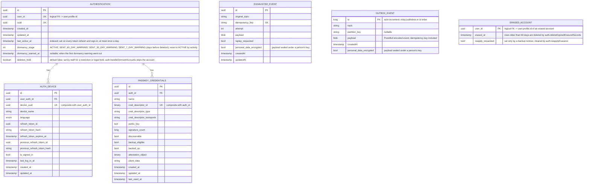

[← Database ER diagrams](README.md)

# Authorization service

Owns login/session/device and WebAuthn passkey state, keyed off `authentication.user_id`
(a logical reference to `user.profile.id`).

`EXHAUSTED_EVENT` is not part of the authorization domain model — it's the shared DLT landing table (`library/outbox`, one instance per service schema) that `KafkaEventConsumer`/`EmbeddedEventConsumer` write to when an event exhausts its retry budget, so a failed event survives a process restart or crash instead of being lost. Every start, and every row an operator sets `replay_requested` on, is replayed through the consumer group's DLT topic by `ExhaustedEventReplayer`, which also exports the parked rows as the `events_exhausted` metric. See [Exhausted events](../exhausted-events.md).

`OUTBOX_EVENT` is not part of the authorization domain model either — it's the shared transactional outbox (`library/outbox`, one instance per service schema). `eventProducer.send` inserts the encoded event in the same transaction as the authorization write, so an event exists exactly when its write committed; `OutboxRelay` then locks the oldest rows (`SELECT … FOR UPDATE`), publishes them to Kafka (or the embedded transport in the monolith) and deletes them. Delivery is at-least-once, deduplicated by consumers through the event's idempotency key. See [Transactional outbox](../transactional-outbox.md).

`ERASED_ACCOUNT` records every account erasure (`AccountEraser`: account deletion and dormant-account deletion), in the same transaction as the erasure, so a record exists exactly when its erasure committed. It holds the user id and the time only and is inserted once (`INSERT IGNORE`). A restore to an earlier point undoes the erasures made after it, so the restore tool reads these records from the latest backup and re-inserts them with `reapply_requested`; a record the restored database already holds is skipped. `auth-reapplyErasures` then erases those accounts again at the app's next start (see [Restoring prod](../../deployment/ansible/README.md#restoring-prod) and [Scheduled jobs](../operations/scheduled-jobs.md)). Rows live 60 days, twice the 30 days of backups. Hidden from NocoDB.
