[← Database ER diagrams](README.md)

# Business service

Largest schema — a business, its staff, services and clients.

```mermaid
erDiagram
    BUSINESS ||--o{ BUSINESS_DASHBOARD : "has"
    BUSINESS ||--o{ BUSINESS_DAY_OFFS : "has"
    BUSINESS ||--o{ BUSINESS_PERMISSION_GRANTS : "grants"
    BUSINESS ||--o{ BUSINESS_WORKING_HOURS : "has"
    BUSINESS ||--o{ CLIENT : "has"
    BUSINESS ||--o{ EMPLOYEE : "employs"
    BUSINESS ||--o{ EMPLOYEE_INVITATION : "sends"
    BUSINESS ||--o{ SERVICE_GROUP : "defines"
    BUSINESS ||--o{ SERVICE : "offers"
    BUSINESS ||--o{ EMPLOYEE_CAN_PROVIDE_SERVICE : "scopes"
    EMPLOYEE ||--o{ EMPLOYEE_CAN_PROVIDE_SERVICE : "can provide"
    SERVICE ||--o{ EMPLOYEE_CAN_PROVIDE_SERVICE : "provided via"
    EMPLOYEE ||--o{ EMPLOYEE_DAY_OFFS : "has"
    EMPLOYEE ||--o{ BUSINESS_PERMISSION_GRANTS : "holds (cascade delete)"
    EMPLOYEE ||--o{ EMPLOYEE_WORKING_HOURS : "has"
    SERVICE_GROUP ||--o{ SERVICE : "groups"

    BUSINESS {
        uuid id PK
        uuid user_id UK "logical FK -> user.profile.id (owner)"
        string name
        string description
        string address
        double latitude
        double longitude
        string currency
        string timezone
        byte working_days
        int client_data_retention_months "default 36, 12 to 120; a client inactive longer than this is deleted"
        string instagram
        string telegram
        string viber
        string whatsapp
        string phone
        timestamp created_at
        timestamp updated_at
    }

    BUSINESS_DASHBOARD {
        uuid id PK
        uuid user_id UK "logical FK -> user.profile.id"
        uuid business_id FK
        timestamp created_at
        timestamp updated_at
    }

    BUSINESS_DAY_OFFS {
        uuid id PK
        uuid business_id FK
        date start_date
        date end_date
        timestamp created_at
        timestamp updated_at
    }

    BUSINESS_PERMISSION_GRANTS {
        uuid id PK
        uuid user_id "logical FK -> user.profile.id; UK with business_id, resource"
        uuid business_id FK
        uuid employee_id FK "indexed; same employee as (user_id, business_id)"
        enum resource "BUSINESS | EMPLOYEES | CLIENTS | SERVICES | APPOINTMENTS; UK with user_id, business_id"
        bool can_view
        bool can_update
        bool can_delete
    }

    BUSINESS_WORKING_HOURS {
        uuid id PK
        uuid business_id FK
        byte day_of_week
        time start_time
        time end_time
        timestamp created_at
        timestamp updated_at
    }

    CLIENT {
        uuid id PK
        uuid business_id FK
        string name
        string lastname
        string phone "nullable; not unique and not indexed, several clients of a business may share it"
        string email "nullable; UK with business_id; at least one of phone/email required on create"
        uuid user_id "logical FK -> user.profile.id, nullable; UK with business_id"
        string description "nullable; business owner's notes about the client"
        timestamp last_activity_at "latest booked visit end, or create/edit/takeover time; indexed with business_id; the business-deleteInactiveClients job deletes the row once it is older than the business retention period"
        boolean deletion_hold "default false; set by staff on the owner's instruction, business-deleteInactiveClients skips the row"
        timestamp source_updated_at
        timestamp created_at
        timestamp updated_at
    }

    EMPLOYEE {
        uuid id PK
        uuid business_id FK
        string name
        string lastname
        string phone
        string email
        uuid user_id "logical FK -> user.profile.id; UK with business_id"
        timestamp source_updated_at
        byte working_days
        timestamp suspended_at "nullable; set = suspended, grants read as NONE"
        timestamp created_at
        timestamp updated_at
    }

    EMPLOYEE_CAN_PROVIDE_SERVICE {
        uuid id PK
        uuid employee_id FK "UK with service_id"
        uuid service_id FK
        uuid business_id FK
    }

    EMPLOYEE_DAY_OFFS {
        uuid id PK
        uuid employee_id FK
        date start_date
        date end_date
        timestamp created_at
        timestamp updated_at
    }

    EMPLOYEE_INVITATION {
        uuid id PK
        uuid business_id FK
        uuid invited_by "logical FK -> user.profile.id"
        string code_hash UK "SHA-256 hex of the invite code, never the plaintext; nullable, cleared once the invitation leaves PENDING so the code can be reused"
        enum status
        timestamp created_at "indexed together with business_id for the daily invitation quota"
        timestamp updated_at "processed rows are deleted 30 days after this"
    }

    EMPLOYEE_WORKING_HOURS {
        uuid id PK
        uuid employee_id FK
        byte day_of_week
        time start_time
        time end_time
        timestamp created_at
        timestamp updated_at
    }

    SERVICE_GROUP {
        uuid id PK
        uuid business_id FK "UK with name"
        string name
        timestamp created_at
        timestamp updated_at
    }

    SERVICE {
        uuid id PK
        uuid business_id FK "UK with group_id, name"
        uuid group_id FK
        string name
        int duration
        string price_currency
        long price_unscaled
        int price_scale
        bool available
        timestamp created_at
        timestamp updated_at
    }

    EXHAUSTED_EVENT {
        uuid id PK
        string original_topic
        string idempotency_key UK
        int attempt
        blob payload
        bool replay_requested
        timestamp createdAt
        timestamp updatedAt
    }

    ERASED_CLIENT {
        uuid client_id PK "logical FK -> client.id of an erased client"
        uuid business_id "logical FK -> business.id"
        timestamp erased_at "rows older than 60 days are deleted by business-deleteExpiredErasureRecords"
        bool reapply_requested "set only by a backup restore, cleared by business-reapplyErasures"
    }

    DATA_EXPORT {
        uuid owner_id PK "the business; logical link to BUSINESS, no FK"
        string state "PENDING | RUNNING | READY | FAILED, stored by name"
        timestamp requested_at
        int attempts "builds started, at most 3"
        uuid claim_id "nullable; the build holding the row"
        timestamp claimed_until "nullable; lease end"
        timestamp finished_at "nullable"
        timestamp expires_at "nullable; finished_at + 72 h, indexed"
        longblob document "nullable; gzipped JSON, only while READY"
    }

    OUTBOX_EVENT {
        long id PK "auto-increment; relay publishes in id order"
        string topic
        string partition_key "nullable"
        blob payload "ProtoBuf-encoded event, idempotency key included"
        timestamp createdAt
    }

    SUBJECT_KEY {
        uuid subject_id PK "the person the key encrypts for; in schema business_short_retention, not business"
        varbinary wrapped_key "60 bytes; the AES-256 key wrapped by the vault master key"
        int master_key_version
        timestamp created_at
    }
```

`DATA_EXPORT` holds the business's data export (one row per business) from the moment the owner requests it until 72 hours after its document was built. It is the shared `library/export` table, so it has no foreign key to `BUSINESS`; deleting the business deletes the row in the same transaction. It holds a copy of every client of the business, so it is not readable in NocoDB. See [Data export](../data-export.md).

`EXHAUSTED_EVENT` is not part of the business domain model — it's the shared DLT landing table (`library/outbox`, one instance per service schema) that `KafkaEventConsumer`/`EmbeddedEventConsumer` write to when an event exhausts its retry budget, so a failed event survives a process restart or crash instead of being lost. Every start, and every row an operator sets `replay_requested` on, is replayed through the consumer group's DLT topic by `ExhaustedEventReplayer`, which also exports the parked rows as the `events_exhausted` metric. See [Exhausted events](../exhausted-events.md).

`OUTBOX_EVENT` is not part of the business domain model either — it's the shared transactional outbox (`library/outbox`, one instance per service schema). `eventProducer.send` inserts the encoded event in the same transaction as the business write, so an event exists exactly when its write committed; `OutboxRelay` then locks the oldest rows (`SELECT … FOR UPDATE`), publishes them to Kafka (or the embedded transport in the monolith) and deletes them. Delivery is at-least-once, deduplicated by consumers through the event's idempotency key. See [Transactional outbox](../transactional-outbox.md).

`ERASED_CLIENT` records every client a business deleted (`DeleteClient` and the `business-deleteInactiveClients` retention job), in the same transaction as the deletion. Clients deleted with their user's account aren't recorded here: `authorization.erased_account` covers them. Like `ERASED_ACCOUNT`, the restore tool re-inserts the records from the latest backup with `reapply_requested`, and `business-reapplyErasures` deletes those clients again and sends `BusinessEvent.ClientDeleted`. Keyed by the client id alone, inserted once (`INSERT IGNORE`), kept 60 days, hidden from NocoDB.

`SUBJECT_KEY` lives in its own schema, `business_short_retention`, created by the same migration: it holds one AES-GCM key per person whose fields this service encrypts, wrapped by the master key from the vault (`library/encryption`). Erasing a person deletes their row in the erasure's transaction, so their encrypted fields become unreadable in the live database at once, and in backups once the last key backup holding the row expires after 7 days. That is why the key schema is separate: it stays out of the binary log and the 30-day dump and gets its own short-lived backup. It holds keys only: the outbox, parked events and exports stay in `business`, and any personal data they copy is encrypted under the person's key. No foreign keys; NocoDB can't read it.
