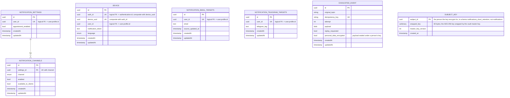

[← Database ER diagrams](README.md)

# Notifications service

Fan-in tables keyed by `user_id`, feeding channel dispatch for a given user across devices/targets.

`notification_email_targets` and `notification_telegram_targets` are not
foreign-keyed to `notification_settings` in the schema — they are joined to a
user's settings at query time via the shared `user_id`.

`EXHAUSTED_EVENT` is not part of the notifications domain model — it's the shared DLT landing table (`library/outbox`, one instance per service schema) that `KafkaEventConsumer`/`EmbeddedEventConsumer` write to when an event exhausts its retry budget, so a failed event survives a process restart or crash instead of being lost. Every start, and every row an operator sets `replay_requested` on, is replayed through the consumer group's DLT topic by `ExhaustedEventReplayer`, which also exports the parked rows as the `events_exhausted` metric. See [Exhausted events](../exhausted-events.md).

`device` is unique on `(auth_id, device_uuid)`, matching authorization. One installation UUID can belong to several accounts, with independent tokens and languages. Repeated `DeviceCreated` events preserve the existing association and reject a conflicting `user_id`.

`SUBJECT_KEY` lives in its own schema, `notifications_short_retention`, created by the same migration: it holds one AES-GCM key per person whose fields this service encrypts, wrapped by the master key from the vault (`library/encryption`). Erasing a person deletes their row in the erasure's transaction, so their encrypted fields become unreadable in the live database at once, and in backups once the last key backup holding the row expires after 7 days. That is why the key schema is separate: it stays out of the binary log and the 30-day dump and gets its own short-lived backup. It holds keys only: parked events stay in `notifications`, and any personal data they copy is encrypted under the person's key. No foreign keys; NocoDB can't read it.
