[← Database ER diagrams](README.md)

# Notifications service

Fan-in tables keyed by `user_id`, feeding channel dispatch for a given user across devices/targets.

```mermaid
erDiagram
    NOTIFICATION_SETTINGS ||--o{ NOTIFICATION_CHANNELS : "has"

    DEVICE {
        uuid id PK
        uuid auth_id UK "logical FK -> authentication.id; composite with device_uuid"
        uuid device_uuid UK "composite with auth_id"
        uuid user_id "logical FK -> user.profile.id"
        text notification_token
        enum language
        timestamp createdAt
        timestamp updatedAt
    }

    NOTIFICATION_SETTINGS {
        uuid id PK
        uuid user_id UK "logical FK -> user.profile.id"
        bool appointment_enabled
        timestamp createdAt
        timestamp updatedAt
    }

    NOTIFICATION_CHANNELS {
        uuid id PK
        uuid settings_id FK "UK with channel"
        enum channel
        bool enabled
        bool available_to_clients
        timestamp createdAt
        timestamp updatedAt
    }

    NOTIFICATION_EMAIL_TARGETS {
        uuid id PK
        uuid user_id UK "logical FK -> user.profile.id"
        text email "nullable; plaintext rows from before 0.18.0 only"
        bytes email_encrypted "nullable until 0.19.0; NULL marks a plaintext row"
        timestamp source_updated_at
        timestamp createdAt
        timestamp updatedAt
    }

    NOTIFICATION_TELEGRAM_TARGETS {
        uuid id PK
        uuid user_id UK "logical FK -> user.profile.id"
        text telegram_tag "nullable; plaintext rows from before 0.18.0 only"
        bytes telegram_tag_encrypted "nullable until 0.19.0; NULL marks a plaintext row"
        timestamp createdAt
        timestamp updatedAt
    }

    EXHAUSTED_EVENT {
        uuid id PK
        string original_topic
        string idempotency_key UK
        int attempt
        blob payload
        bool replay_requested
        bool personal_data_encrypted "payload sealed under a person's key"
        timestamp createdAt
        timestamp updatedAt
    }

    SUBJECT_KEY {
        uuid subject_id PK "the person the key encrypts for; in schema notifications_short_retention, not notifications"
        varbinary wrapped_key "nullable; 60 bytes, the AES-256 key wrapped by the vault master key; NULL in a tombstone"
        int master_key_version "nullable; NULL in a tombstone"
        timestamp created_at
        timestamp shredded_at "nullable; set when the key is shredded, the first time kept"
    }
    SHREDDED_SUBJECT {
        uuid subject_id PK "a person whose key in notifications_short_retention was shredded"
        timestamp shredded_at "the first shredding time"
    }
```

`notification_email_targets` and `notification_telegram_targets` are not
foreign-keyed to `notification_settings` in the schema — they are joined to a
user's settings at query time via the shared `user_id`.

Both targets are stored encrypted under the user's own key (`email_encrypted`, `telegram_tag_encrypted`, `library/encryption`, keyed by `user_id`), so account deletion, which deletes the rows and shreds that key, leaves nothing readable in backups. They are only ever looked up by `user_id`, so they have no blind index. A row whose key is missing reads as no target. Rows written before 0.18.0 keep their plaintext columns until the `notifications-encryptPlaintextTargets` job encrypts them and sets those columns to NULL; a write to such a row encrypts it too. 0.19.0 drops the plaintext columns.

`EXHAUSTED_EVENT` is not part of the notifications domain model — it's the shared DLT landing table (`library/outbox`, one instance per service schema) that `KafkaEventConsumer`/`EmbeddedEventConsumer` write to when an event exhausts its retry budget, so a failed event survives a process restart or crash instead of being lost. Every start, and every row an operator sets `replay_requested` on, is replayed through the consumer group's DLT topic by `ExhaustedEventReplayer`, which also exports the parked rows as the `events_exhausted` metric. See [Exhausted events](../exhausted-events.md).

`device` is unique on `(auth_id, device_uuid)`, matching authorization. One installation UUID can belong to several accounts, with independent tokens and languages. Repeated `DeviceCreated` events preserve the existing association and reject a conflicting `user_id`.

`SUBJECT_KEY` lives in its own schema, `notifications_short_retention`, created by the same migration: it holds one AES-GCM key per person whose fields this service encrypts, wrapped by the master key from the vault (`library/encryption`). Erasing a person replaces their key with a tombstone in the erasure's transaction (`wrapped_key` and `master_key_version` NULL, `shredded_at` set; written even for a person who never had a key, and never deleted), so their encrypted fields become unreadable in the live database at once, and in backups once the last key backup holding the key expires after 7 days. The tombstone stops a late write from creating a fresh key for the erased person: `encryptor` gives none and `isShredded` reports it. That is why the key schema is separate: it stays out of the binary log and the 30-day dump and gets its own short-lived backup. It holds keys only: parked events stay in `notifications`, and any personal data they copy is encrypted under the person's key. No foreign keys; NocoDB can't read it.

`SHREDDED_SUBJECT` is the binlogged record of those tombstones, written in the same transaction (`INSERT IGNORE`, first time kept). The key schema is backed up only every 5 minutes, so a restore loads the newest key dump and then turns every key listed here back into a tombstone: a person erased after that key dump doesn't get their key back. Ids only, never deleted, like the tombstones; NocoDB can't read it.
