[← Database ER diagrams](README.md)

# User service

Smallest schema — the canonical user profile and the legal documents users accepted.

```mermaid
erDiagram
    PROFILE ||--o{ LEGAL_DOCUMENT_ACCEPTANCE : "accepts (cascade delete)"
    LEGAL_DOCUMENT_VERSION ||--o{ LEGAL_DOCUMENT_ACCEPTANCE : "accepted as"

    PROFILE {
        uuid id PK
        string name
        string last_name
        string email UK
        string phone UK "nullable; blank stored as NULL"
        timestamp created_at
        timestamp updated_at
    }

    LEGAL_DOCUMENT_VERSION {
        string document PK "PRIVACY_POLICY | TERMS_OF_SERVICE, stored by name"
        string version PK
        string url
        timestamp effective_at
    }

    LEGAL_DOCUMENT_ACCEPTANCE {
        uuid user_id PK, FK
        string document PK, FK
        string version PK, FK "(document, version) references LEGAL_DOCUMENT_VERSION"
        timestamp accepted_at
    }

    EXHAUSTED_EVENT {
        uuid id PK
        string original_topic
        string idempotency_key UK
        int attempt
        blob payload
        bool replay_requested
        timestamp createdAt
        timestamp updatedAt
    }

    DATA_EXPORT {
        uuid owner_id PK "the user; logical link to PROFILE, no FK"
        string state "PENDING | RUNNING | READY | FAILED, stored by name"
        timestamp requested_at
        int attempts "builds started, at most 3"
        uuid claim_id "nullable; the build holding the row"
        timestamp claimed_until "nullable; lease end"
        timestamp finished_at "nullable"
        timestamp expires_at "nullable; finished_at + 72 h, indexed"
        longblob document "nullable; gzipped JSON encrypted under key_id, only while READY"
        uuid key_id "nullable; the document's own key in <svc>_short_retention.subject_key"
    }

    OUTBOX_EVENT {
        long id PK "auto-increment; relay publishes in id order"
        string topic
        string partition_key "nullable"
        blob payload "ProtoBuf-encoded event, idempotency key included"
        timestamp createdAt
    }

    SUBJECT_KEY {
        uuid subject_id PK "the person the key encrypts for; in schema user_short_retention, not user"
        varbinary wrapped_key "60 bytes; the AES-256 key wrapped by the vault master key"
        int master_key_version
        timestamp created_at
    }
```

`LEGAL_DOCUMENT_VERSION` holds the published versions of each legal document; the operator inserts them by hand (see [Legal documents](../legal-documents.md)), and the current version of a document is its row with the latest `effective_at` that has passed. `LEGAL_DOCUMENT_ACCEPTANCE` is append-only: one row per user and version accepted, never updated (a repeat is ignored, keeping the first time), deleted with the profile. A version that someone accepted can't be deleted (`ON DELETE RESTRICT`).

`DATA_EXPORT` holds the user's personal data export (one row per user) from the moment it is requested until 72 hours after its document was built. It is the shared `library/export` table, so it has no foreign key to `PROFILE`; account deletion deletes the row in the same transaction as the profile. It holds a copy of the user's data from every service, so it is not readable in NocoDB, and the document is encrypted under a random key of its own (`key_id`), shredded when the row loses its document. See [Data export](../data-export.md).

`EXHAUSTED_EVENT` is not part of the user domain model — it's the shared DLT landing table (`library/outbox`, one instance per service schema) that `KafkaEventConsumer`/`EmbeddedEventConsumer` write to when an event exhausts its retry budget, so a failed event survives a process restart or crash instead of being lost. Every start, and every row an operator sets `replay_requested` on, is replayed through the consumer group's DLT topic by `ExhaustedEventReplayer`, which also exports the parked rows as the `events_exhausted` metric. See [Exhausted events](../exhausted-events.md).

`OUTBOX_EVENT` is not part of the user domain model either — it's the shared transactional outbox (`library/outbox`, one instance per service schema). `eventProducer.send` inserts the encoded event in the same transaction as the user write, so an event exists exactly when its write committed; `OutboxRelay` then locks the oldest rows (`SELECT … FOR UPDATE`), publishes them to Kafka (or the embedded transport in the monolith) and deletes them. Delivery is at-least-once, deduplicated by consumers through the event's idempotency key. See [Transactional outbox](../transactional-outbox.md).

`SUBJECT_KEY` lives in its own schema, `user_short_retention`, created by the same migration: it holds one AES-GCM key per person whose fields this service encrypts, wrapped by the master key from the vault (`library/encryption`). Erasing a person deletes their row in the erasure's transaction, so their encrypted fields become unreadable in the live database at once, and in backups once the last key backup holding the row expires after 7 days. That is why the key schema is separate: it stays out of the binary log and the 30-day dump and gets its own short-lived backup. It holds keys only: the outbox, parked events and exports stay in `user`, and any personal data they copy is encrypted under the person's key. No foreign keys; NocoDB can't read it.
