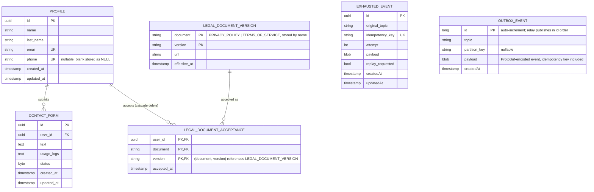

[← Database ER diagrams](README.md)

# User service

Smallest schema — the canonical user profile, inbound contact-form submissions, and the legal documents users accepted.

`LEGAL_DOCUMENT_VERSION` holds the published versions of each legal document; the operator inserts them by hand (see [Legal documents](../legal-documents.md)), and the current version of a document is its row with the latest `effective_at` that has passed. `LEGAL_DOCUMENT_ACCEPTANCE` is append-only: one row per user and version accepted, never updated (a repeat is ignored, keeping the first time), deleted with the profile. A version that someone accepted can't be deleted (`ON DELETE RESTRICT`).

`EXHAUSTED_EVENT` is not part of the user domain model — it's the shared DLT landing table (`core/data/eventstreaming/data`, one instance per service schema) that `KafkaEventConsumer`/`EmbeddedEventConsumer` write to when an event exhausts its retry budget, so a failed event survives a process restart or crash instead of being lost. Every start, and every row an operator sets `replay_requested` on, is replayed through the consumer group's DLT topic by `ExhaustedEventReplayer`, which also exports the parked rows as the `events_exhausted` metric. See [Exhausted events](../exhausted-events.md).

`OUTBOX_EVENT` is not part of the user domain model either — it's the shared transactional outbox (`core/data/eventstreaming/data`, one instance per service schema). `eventProducer.send` inserts the encoded event in the same transaction as the user write, so an event exists exactly when its write committed; `OutboxRelay` then locks the oldest rows (`SELECT … FOR UPDATE`), publishes them to Kafka (or the embedded transport in the monolith) and deletes them. Delivery is at-least-once, deduplicated by consumers through the event's idempotency key. See [Transactional outbox](../transactional-outbox.md).
