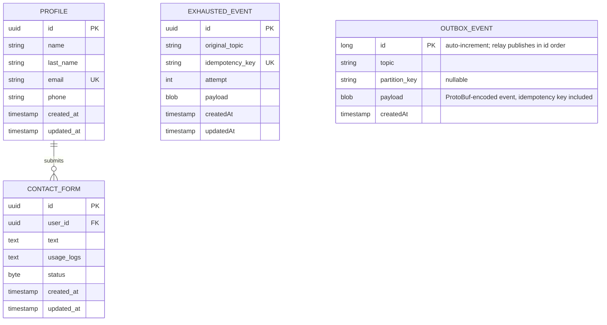

[← Database ER diagrams](README.md)

# User service

Smallest schema — the canonical user profile and inbound contact-form submissions.

`EXHAUSTED_EVENT` is not part of the user domain model — it's the shared DLT landing table (`core/data/eventstreaming/data`, one instance per service schema) that `KafkaEventConsumer`/`EmbeddedEventConsumer` write to when an event exhausts its retry budget, so a failed event survives a process restart or crash instead of being lost. See `AGENTS.md`'s event-streaming retry design notes.

`OUTBOX_EVENT` is not part of the user domain model either — it's the shared transactional outbox (`core/data/eventstreaming/data`, one instance per service schema). `eventProducer.send` inserts the encoded event in the same transaction as the user write, so an event exists exactly when its write committed; `OutboxRelay` then locks the oldest rows (`SELECT … FOR UPDATE`), publishes them to Kafka (or the embedded transport in the monolith) and deletes them. Delivery is at-least-once, deduplicated by consumers through the event's idempotency key. See [Transactional outbox](../transactional-outbox.md).
