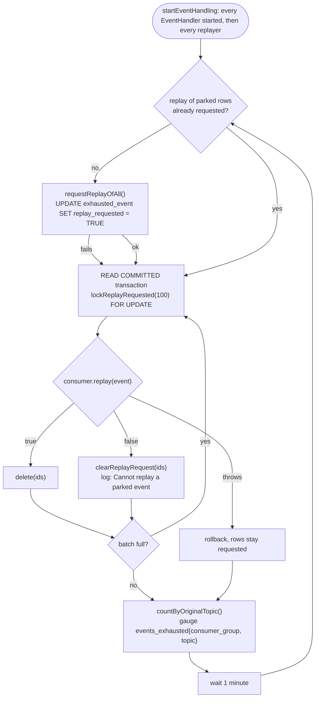

# Exhausted events

An event whose handler fails every attempt is parked in its consumer's `exhausted_event` table. It is then retried only when someone replays it. A parked `AuthEvent.UserDeleted` is an erasure that hasn't run, so parked events raise an alert and can be replayed without touching the code.

## How an event gets parked

Each consumer group (`<service>_group`) retries a failing event through its own DLT topic (`<topic>_<consumerGroup>_dlt`, `DltRetry`), with backoff, up to `DltRetry.DEFAULT_MAX_ATTEMPTS` (3) attempts. The last failure is saved to the consumer's own schema (`KafkaEventConsumer` / `EmbeddedEventConsumer` → `ExhaustedEventDataSource.save`): the original topic, the encoded event, the attempt count and the DLT chain's own random key (`idempotency_key`, unique). Only the consumer group that failed parks the event. Other services that handled the same event successfully are unaffected.

## Replay

`ExhaustedEventReplayer` (`core/data/eventstreaming/impl`, one per service scope, bound in both transport modules) runs a loop on the application scope:



- **On every start** the replayer marks every row parked so far for replay (retried on the next tick if the database is down), so deploying a fix replays what the bug parked.
- **By hand**: `UPDATE exhausted_event SET replay_requested = TRUE WHERE …` in the consumer's schema. The next tick, within a minute, replays it. Every instance runs the loop, and the row lock makes each row replay once.
- **`consumer.replay(event)`** publishes the event to *this* consumer group's DLT topic with attempt 0 and a new random key, so it gets every attempt again and no other service sees it. Kafka re-sends the stored payload (`DltEvent`). The embedded transport decodes it with the receiver's type and publishes an `EmbeddedDltEvent`. It returns `false`, and the row is kept with its request cleared, when this consumer has no receiver for the topic any more, when the payload no longer decodes, or (embedded) when the consumer hasn't started yet. `startEventHandling` starts the replayers after every `EventHandler`, so the embedded subscriptions exist before the first replay.
- **An event that fails again** is parked again as a new row under its new key. The replayed row was already deleted when the replay committed, and the new row isn't requested, so a poison event costs three attempts per start, not a loop.
- Delivery stays at-least-once. If the commit fails after a publish, the row is replayed again later, and consumers deduplicate on the event's own idempotency key (`IdempotentDelivery`). An embedded replay lives in memory, so a crash between the commit and the handler loses it, like any other embedded event.

## Alert

`EventsExhausted` (`deployment/prod/monitoring/prometheus/node_alerts.yml`, critical) fires while `max by (consumer_group, topic) (events_exhausted) > 0`. `max` and not `sum`, because every instance reports the same table (two during a deploy). A topic disappears from the gauge once its rows are gone, which resolves the alert.

## Operator steps

1. Find the failure in the logs: `Error while processing event for topic: <topic>` in the consumer's service.
2. Fix the cause. A bug fix replays by itself on deploy. For a cause outside the code (a provider outage, bad data fixed by hand), request the replay:
   ```sql
   UPDATE <schema>.exhausted_event SET replay_requested = TRUE WHERE original_topic = '<topic>';
   ```
   The schema is the consumer's service: `auth_group` → `authorization`, every other `<service>_group` → `<service>`.
3. The alert clears within a minute or two once the replay succeeds. If the event fails again, it is parked again and the alert stays.
4. A row logged as `Cannot replay a parked event` can't be replayed by this version. Handle it by hand, then `DELETE` it, or the alert stays.
