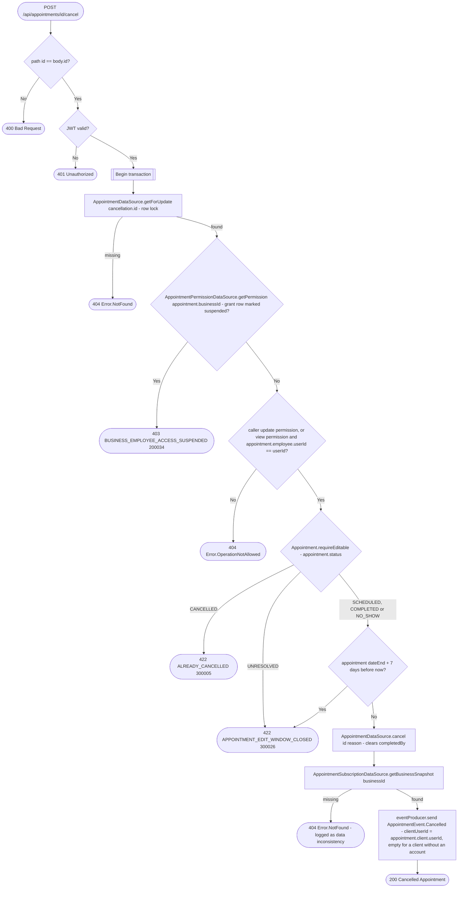

# Cancel appointment

`POST /api/appointments/{id}/cancel` → `CancelAppointment`

A scheduled, completed or no-show appointment can be cancelled within 7 days
of its end. Cancellation is terminal: a cancelled appointment cannot be edited,
completed, marked as no-show or restored. Staff create a new appointment instead.
Repeating a cancellation returns `ALREADY_CANCELLED` (300005) without another event.
Unresolved appointments are immutable and return `APPOINTMENT_EDIT_WINDOW_CLOSED`
(300026). Cancellation clears `completedBy` and keeps the supplied reason. The operation reads the
appointment with `getForUpdate` (`SELECT … FOR UPDATE`) as its first read,
so the `Appointment.requireEditable()` check and the write see the same
locked row. The business is taken from the stored appointment; the body
(`AppointmentCancellation`) carries only the appointment id and the reason. The appointment is fetched before the permission check so a `view`-only
employee can be let through when it's their own — see [Managing your own
resource on a `view`
grant](../../object-permissions.md#managing-your-own-resource-on-a-view-grant).

**Consumed by:** `AppointmentEvent.Cancelled` → [notifications: notify the
client](../notifications/on-appointment-cancelled.md).
