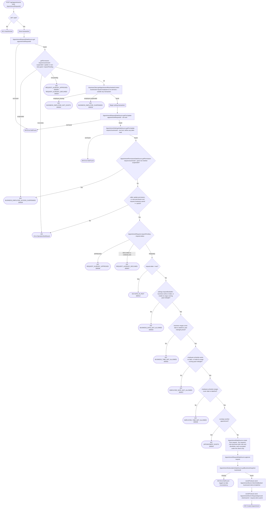

# Create appointment from a pending request

`POST /api/appointments` → `CreateAppointment` (via `appointmentRequestId`)

Converts an already-existing `AppointmentRequest` into a confirmed
`Appointment`. Shares its verification logic (workday/worktime/overlap
checks) with the auto-approval branch of [Create appointment
request](create-appointment-request.md). A `view`-only employee can
convert their own request; see [Managing your own resource on a `view`
grant](../../object-permissions.md#managing-your-own-resource-on-a-view-grant).

The slot must fit both the business schedule (`AppointmentSettings.schedule`)
and the requested employee's schedule as it is now, so the operation asks the
business service for the employee (`BusinessClient.getAppointmentRescheduleContext`
with no services) before it books. That call is made outside any transaction:
a first short transaction reads the request with a plain read and runs the
permission and status checks, so a caller without access never reaches the
business service, and the writing transaction repeats every check after its
locks. A working range whose end is before its start runs past midnight,
and ranges that touch across days join, so a slot may cross midnight.

In the writing transaction the request is read with
`AppointmentRequestDataSource.getForUpdate` (`SELECT … FOR UPDATE`) as the
first statement and must still be `PENDING` (`AppointmentRequest.requirePending()`).
That row lock is what serializes an approval against a concurrent
[decline](decline-appointment-request.md), a second approval, or the
`cancelOutdated` job: the loser waits for the winner to commit and then sees
the new status instead of overwriting it. The request lock is taken before the
settings lock, and both come before the first plain read, the permission
lookup. InnoDB fixes the transaction's snapshot at its first plain read, so a
permission lookup before the settings lock let an approval that waited behind
another booking check overlaps against a snapshot from before that booking
committed, and book the same slot twice.

**Consumed by:** `AppointmentEvent.RequestApproved` → [notifications: notify
the client](../notifications/on-appointment-request-approved.md);
`AppointmentEvent.ClientVisitBooked` → [business: record the client's
visit](../business/on-client-visit-booked.md).
