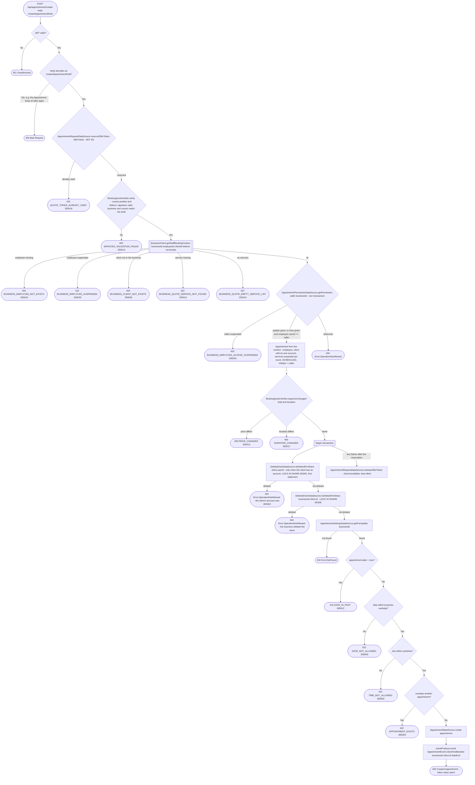

# Create instant appointment

`POST /api/appointments/instant` → `CreateInstantAppointment`

An employee books an existing client of the business straight into a
schedule, with no request to approve (a walk-in, or a booking taken by
phone). An employee booking themselves is a client booking for themselves
and goes through [Create appointment request](create-appointment-request.md).
The body (`InstantAppointmentDraft`) carries only ids and the quote: the
business, the employee whose schedule it is, the client id, the services with
counts, the date, a note and the quote token from `POST
/api/business/{businessId}/service/quote`. Everything stored comes from the business
service, never from the body.

Business resolves the employee, the client and the services through [Get
staff booking context](../business/get-staff-booking-context.md): the
employee must belong to the business and not be suspended (422
`BUSINESS_EMPLOYEE_SUSPENDED`), and the client must be a client row of that
business (404 `BUSINESS_CLIENT_NOT_EXISTS`). An employee who needs a new
walk-in client creates it first.

Who may book into that schedule is today's appointments permission,
checked with `assertOrSelf(UPDATE, actorId = caller, assigneeId =
employee.userId)` on `appointment_permission_grants`: a caller with the
update grant may book any employee of the business, a caller with only the
view grant only themselves, and anyone else gets 404
(`Error.OperationNotAllowed`). A suspended caller gets 403
`BUSINESS_EMPLOYEE_ACCESS_SUSPENDED`. The check runs in its own short
transaction before the booking transaction, so the booking transaction
still takes its locks before its first plain read.

The quote works as for [Create appointment
request](create-appointment-request.md), through the same
`BookingQuoteVerifier`: the token is reserved once (`reserveOfferToken`,
`SET NX`) before anything else and released if the booking then fails, its
signature, business and service counts must match the draft, and the price
and duration recomputed from business must equal the quoted ones.

The stored client account (`client_user_id`) is the client row's own
account from business, empty for a client without one. The initiator
(`initiator_user_id`) is the employee.

A booking for a client whose account was deleted, or a client the business
deleted, is rejected: it would otherwise store their details after the
erasure ran. `deleted_user` (only when the client has an account) and
`deleted_client` are read with a shared lock as the transaction's first
statements, so a deletion running at the same moment either finishes first
(and the booking is rejected) or waits for the booking to commit and then
erases it.

No event is sent, as before: the client isn't notified of an appointment the
employee booked for them.

**Consumed by:** `AppointmentEvent.ClientVisitBooked` → [business: record the client's
visit](../business/on-client-visit-booked.md).
