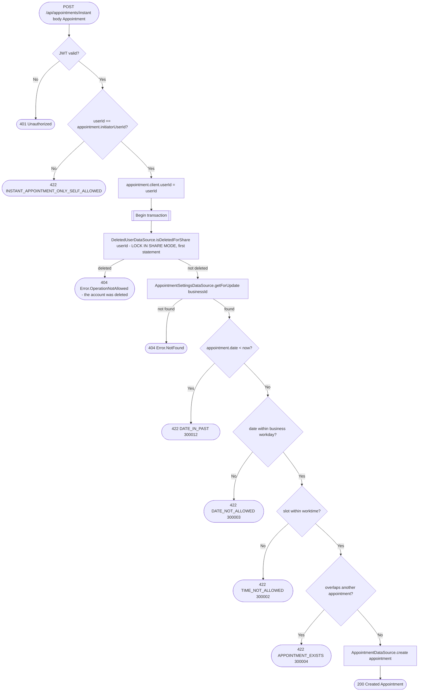

# Create instant appointment

`POST /api/appointments/instant` → `CreateAppointment` (`isInstant = true`)

Books a slot directly without going through the request/approval flow.
Restricted to self-booking: the caller must be the appointment's own
client, checked via `userId == appointment.initiatorUserId` before anything else runs.
The stored client account (`client.userId`, `client_user_id`) is set to the
caller, whatever the body says.
No request-approval event fires here since there was never a pending
request. That self-check is this operation's only authorization gate —
there is no business-permission check, since the caller is the client
booking with the business, not a staff member.

A booking from an account whose deletion appointments has already handled
is rejected: it would otherwise store the deleted person's details after
the erasure ran. The check reads `deleted_user` with a shared lock as the
transaction's first statement, so a deletion running at the same moment
either finishes first (and the booking is rejected) or waits for the
booking to commit and then erases it by `client_user_id`.

