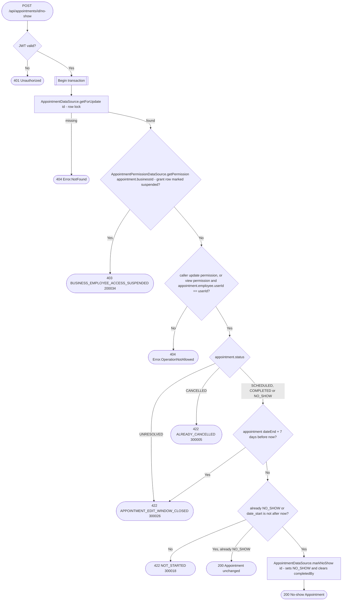

# Mark appointment as no-show

`POST /api/appointments/{id}/no-show` → `MarkAppointmentNoShow`

Records that the client missed the appointment. Only an appointment that has
already started can be marked, and it may be either still `SCHEDULED` or
already `COMPLETED` by staff through [Complete appointment](complete-appointment.md)
or by the automatic end-of-day job.
Marking a `COMPLETED` appointment as no-show clears its `completedBy`.
Both statuses can be changed only within 7 days of the appointment's end.
A no-show may be corrected back to completed through the completion route.
Cancelled appointments remain terminal and must be replaced by a new booking.
`UNRESOLVED` appointments are immutable and return
`APPOINTMENT_EDIT_WINDOW_CLOSED` (300026).
Marking an appointment that is already `NO_SHOW` succeeds unchanged. The
operation reads the appointment with `getForUpdate` (`SELECT … FOR UPDATE`)
as its first read, checks status and start time itself, and only then calls
the unconditional `markNoShow` write, so a concurrent cancel cannot slip in
between.

The business is taken from the stored appointment, never from the request.
The appointment is fetched before the permission check so a `view`-only
employee can be let through when it's their own — see [Managing your own
resource on a `view`
grant](../../object-permissions.md#managing-your-own-resource-on-a-view-grant).

No event is published.
