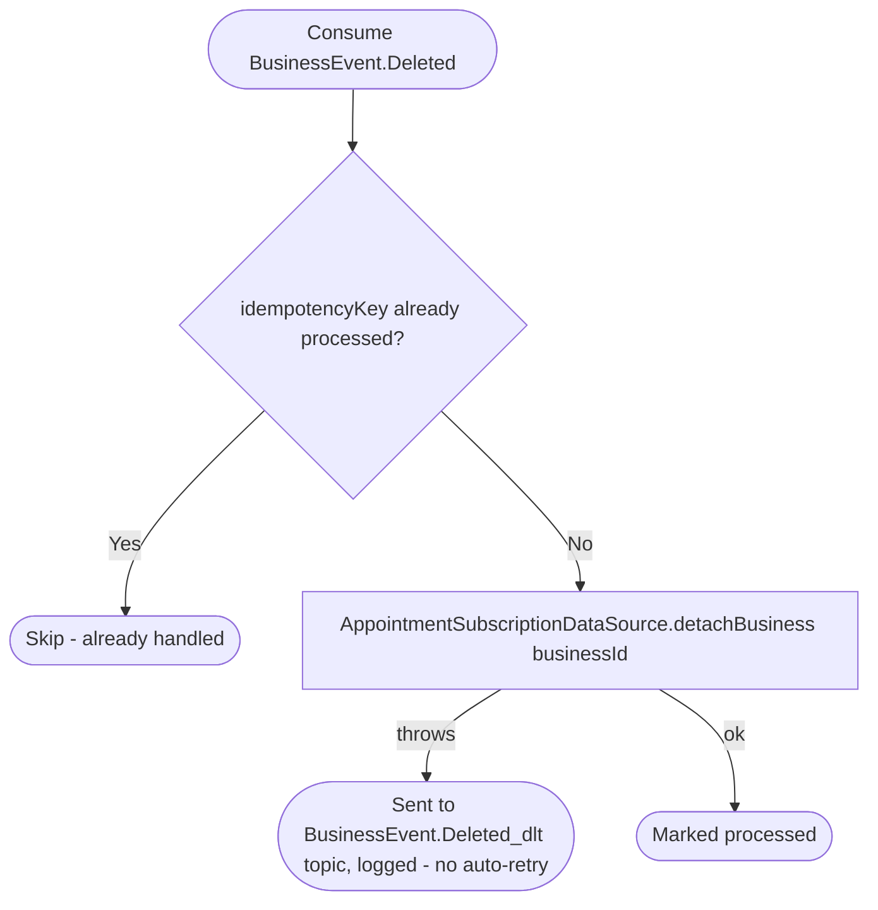

# React to business deletion

Kafka topic `BusinessEvent.Deleted` → `AppointmentEventHandler` → `DeleteModule`

Produced by the business service's reaction to account deletion — see
[React to user deletion (business)](../business/on-user-deleted.md), which
emits one `BusinessEvent.Deleted` per business owned by the deleted user.
Since 0.18.0 [React to user deletion (appointments)](on-user-deleted.md)
already drops the businesses the user owned (by `owner_user_id`), so this
event usually finds nothing. It still covers a business whose owner isn't
filled in yet (rows from before 0.18.0, until the
`appointments-fillBusinessOwners` job reaches them), and it is kept for a
future business deletion that doesn't come from an account deletion.
Detaches the appointments module's own copy of the business (its
subscription/settings/permissions rows are left in place here; deleting
them is [React to user deletion
(appointments)](on-user-deleted.md)'s job when the owning user is the one
removed — a business without an owner is simply no longer bookable).

