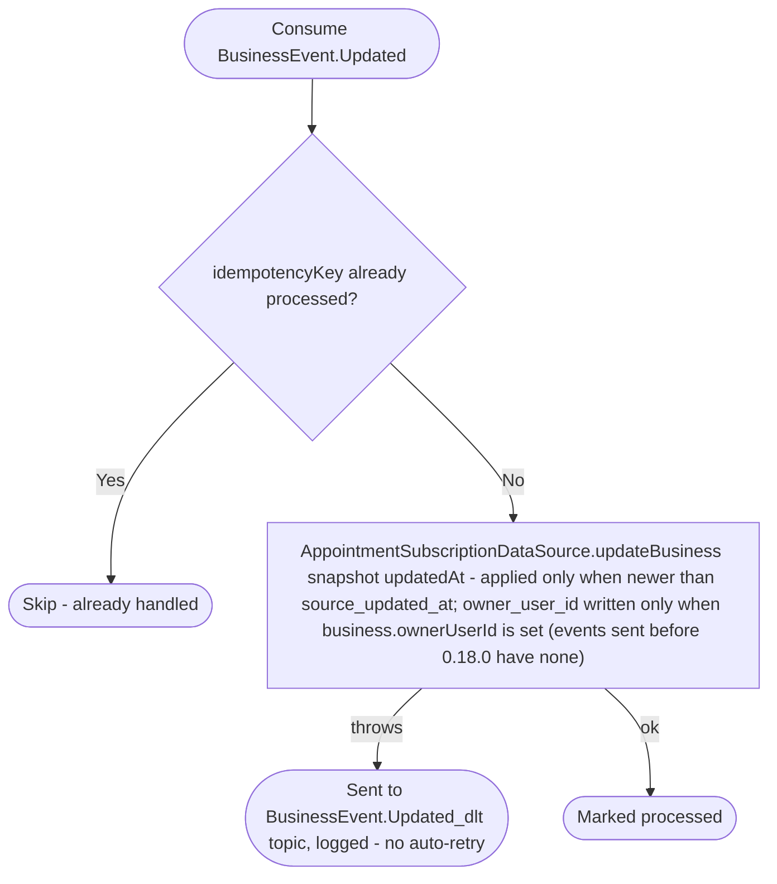

# React to business update

Kafka topic `BusinessEvent.Updated` → `AppointmentEventHandler` → `UpdateBusinessInformation`

Produced by [Update business](../business/update-business.md). Keeps the
appointments module's cached `BusinessSnapshot` (name, address, time zone,
schedule) in sync so date/time validation and cancellation notifications
use current business data without an inline call to the business service.
It also keeps `owner_user_id` (`BusinessDTO.ownerUserId`), which account
deletion uses to find the businesses a user owns, so that a future business
transfer moves it. An `Updated` sent before 0.18.0 has no owner: the stored
owner is kept (`updateBusiness` writes the owner only when the event has
one). An update never creates a business row. Until 0.19.0 the
[`appointments-fillBusinessOwners` job](../scheduled-jobs.md) fills owners
for rows created before 0.18.0.

