# React to client deletion

Kafka topic `BusinessEvent.ClientDeleted` → `AppointmentEventHandler` → `DeleteClientAppointmentData`

Produced by [Delete client](../business/delete-client.md) and by the
[`business-deleteInactiveClients` job](../scheduled-jobs.md), which deletes
clients inactive for longer than the business's retention period, and, after a
backup restore, by the [`business-reapplyErasures` job](../scheduled-jobs.md). Erases one client
from one business's appointments, in one transaction, matched by
`business_id` and `client_id` (the business's client row id, indexed on both
tables). Nothing changes at other businesses, and a client with an account
keeps their account.

- Their upcoming scheduled appointments are cancelled with the reason
  "Client was removed by the business", freeing the slots. The employee of
  each one is told through `AppointmentEvent.CancelledForDeletedClient` with
  `cause = REMOVED_BY_BUSINESS`, and a client with an account gets
  `AppointmentEvent.Cancelled` with that reason. An employee who is the
  client themselves gets only the client notification.
- Every appointment of theirs at the business then has its client name set
  to "Deleted Client" and phone, email and `client_user_id` cleared. The
  rows, their `client_id` and the history stay for the business.
- Their requests at the business are deleted.

Recording the client in `deleted_client` (`INSERT IGNORE`, client id,
business id and the time of the first deletion) comes first, then
cancelling, which is the only locking read on appointments. The record
closes two races, because this event has no order relative to the others:

- [React to a client getting an account](on-client-linked.md) can arrive
  after this one, for a link business made before the delete. It reads
  `deleted_client` first and erases the rows it just moved and linked.
- A booking that read the client's details from business before the delete
  can reach appointments after it. Both booking paths read `deleted_client`
  (`LOCK IN SHARE MODE`) and reject the booking with
  `Error.OperationNotAllowed`.

The shared lock makes a deletion and a link or booking wait for each other
in either order (`DeletedClientLockMariaDbTest`).

```mermaid
flowchart TD
    Start([Consume BusinessEvent.ClientDeleted]) --> Claim{"IdempotentDelivery.claim event:appointments:topic:idempotencyKey"}
    Claim -- already processed --> Skip([Skip - SKIPPED_DUPLICATE])
    Claim -- held by another delivery --> Wait[Re-claim every second, up to the 1-minute claim TTL] --> Claim
    Claim -- claimed --> Tx[[Begin transaction]]
    Tx --> Mark["DeletedClientDataSource.markDeleted businessId clientId - INSERT IGNORE into deleted_client"]
    Mark --> Upcoming["AppointmentDataSource.getUpcomingIdsOfClientForUpdate businessId clientId now - SELECT id FOR UPDATE, SCHEDULED and date_start after now"]
    Upcoming --> Load["AppointmentDataSource.getAllByIds upcoming ids - plain read with services, after the lock; no query when there are none"]
    Load --> Any{any upcoming appointment?}
    Any -- No --> Cancel
    Any -- Yes --> Snapshot{"AppointmentSubscriptionDataSource.getBusinessSnapshot businessId"}
    Snapshot -- missing --> Log[Log error, nobody notified] --> Cancel
    Snapshot -- found --> Cancel
    Cancel["AppointmentDataSource.cancelAll upcoming ids 'Client was removed by the business' - one UPDATE to CANCELLED"]
    Cancel --> Anon["AppointmentDataSource.anonymizeClient businessId clientId - client_name = Deleted Client, phone, email and client_user_id null, note cleared, cancellation and price adjustment reasons kept"]
    Anon --> DelReq["AppointmentRequestDataSource.deleteForClient businessId clientId"]
    DelReq --> Known{business snapshot found?}
    Known -- No --> Shred
    Known -- Yes --> Each[For each cancelled appointment]
    Each --> ToEmployee{employee is the client themselves?}
    ToEmployee -- No --> SendEmployee["eventProducer.send AppointmentEvent.CancelledForDeletedClient employeeUserId from to timeZone businessName cause = REMOVED_BY_BUSINESS"]
    ToEmployee -- Yes --> ToClient
    SendEmployee --> ToClient{client has an account?}
    ToClient -- Yes --> SendClient["eventProducer.send AppointmentEvent.Cancelled clientUserId ... reason 'Client was removed by the business'"]
    ToClient -- No --> Shred
    SendClient --> Shred
    Shred["SubjectKeys.shred clientId - last, unrelayed RequestCreated rows of the client are dropped"] --> Processed([markProcessed - kept 1 hour])
    Shred -- any step throws, rolled back --> Release[Release the claim] --> Dlt["Retried through business.client_deleted_appointments_dlt, up to 3 attempts"]
    Dlt -- every attempt failed --> Parked(["Saved to exhausted_event - EventsExhausted alert, replayed on the next start or when replay_requested is set"])
```

**Consumed by:**
- `AppointmentEvent.CancelledForDeletedClient` → [notifications: tell the employee](../notifications/on-appointment-cancelled-for-deleted-client.md).
- `AppointmentEvent.Cancelled` → [notifications: tell the client](../notifications/on-appointment-cancelled.md).
