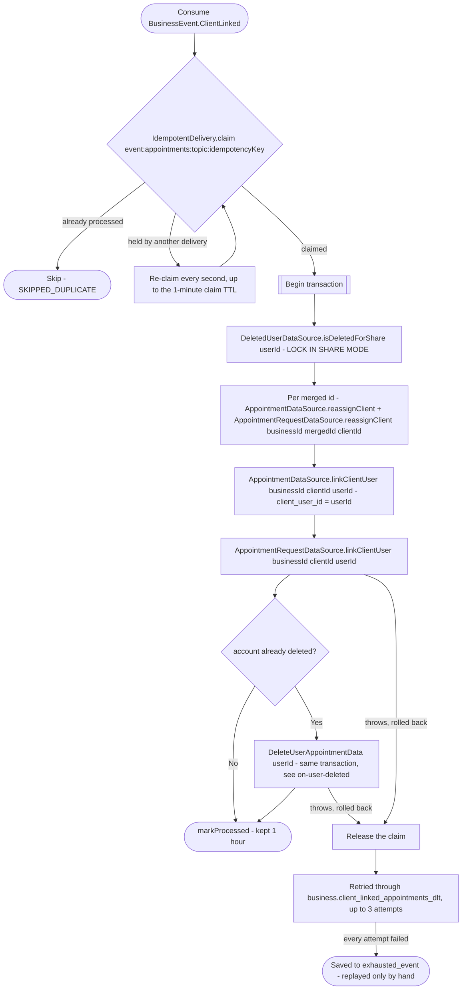

# React to a client getting an account

Kafka topic `BusinessEvent.ClientLinked` → `AppointmentEventHandler` → `LinkClientUser`

Says: client row `clientId` of the business belongs to `userId`, and the
rows `mergedClientIds` were deleted as its duplicates. Produced by:

- [Get appointment booking context](../business/get-appointment-booking-context.md),
  when a user's first booking takes over a detached client of the business
  (the row holding their email or phone) and deletes any other detached
  row holding their contacts;
- [React to user profile update (business)](../business/on-user-updated.md),
  when the user's new phone or email belongs to detached clients of a
  business where they are already a client, which are deleted as
  duplicates of their row (one event per kept row).

Appointments and requests store the business's client row id as
`client_id`, and appointments booked for a row while it had no account
have `client_user_id` empty. In one transaction this moves every row of
the duplicates onto `clientId`, then records the account on all of the
kept client's appointments and requests, so that [account
deletion](on-user-deleted.md), which erases by `client_user_id`, finds
them. The stored name, phone and email are a snapshot of booking time and
are left as they are. Moving and linking travel in one event, because two
events on separate topics could arrive in either order and leave moved rows
without the account.

`BusinessEvent.ClientLinked` and `AuthEvent.UserDeleted` still travel on
separate topics with no ordering between them. If the user deleted their
account right after the event was published, the deletion may be handled
first and find nothing on these rows. The deletion records the user in
`deleted_user` as its first statement, and this reads it first with a
shared lock:

- If the deletion has committed, the record is there, and the rows just
  moved and linked are erased in the same transaction
  (`DeleteUserAppointmentData`: cancel the upcoming ones and tell their
  employees, clear the details, delete the requests).
- If the deletion is still running, the read waits for it, then sees the
  record.
- If the deletion starts later, its insert waits for this transaction, and
  then it erases these rows by `client_user_id` itself.

`DeletedUserLockMariaDbTest` pins both waits against a real MariaDB.

**Consumed by:** `AppointmentEvent.CancelledForDeletedClient`, sent by the erasure when the account was already deleted → [notifications: tell the employee](../notifications/on-appointment-cancelled-for-deleted-client.md).
