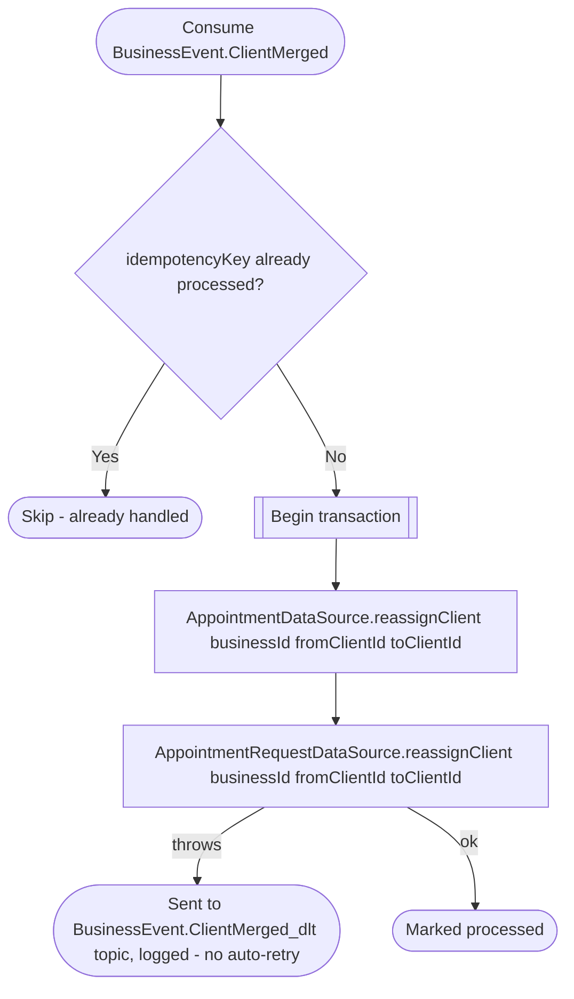

# React to a client merge

Kafka topic `BusinessEvent.ClientMerged` → `AppointmentEventHandler` → `MergeClient`

Produced by [Get appointment booking context](../business/get-appointment-booking-context.md)
(a user's first booking takes over one detached client and merges the
others holding their phone or email) and [React to user profile
update](../business/on-user-updated.md) (a user's new phone or email
belongs to a detached client of a business where they are already
integrated). In both cases the business service deleted the detached
`fromClientId` row as a duplicate of `toClientId`. Appointments and
appointment requests store the client's id as a logical `client_id`, so
this moves every row of that business from the deleted id to the kept one
and the business keeps the person's history in one place. The stored
client name, phone and email are a snapshot of booking time and are left
as they are.

