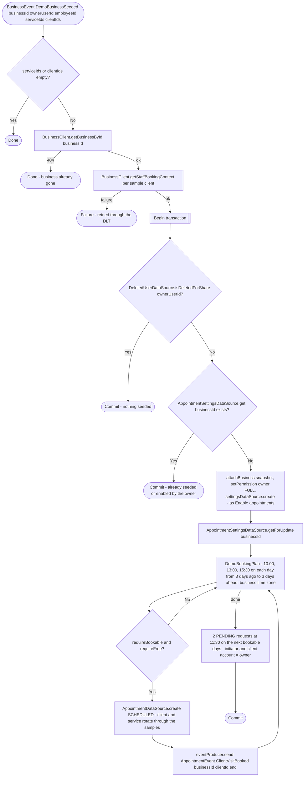

# React to a seeded demo business

`BusinessEvent.DemoBusinessSeeded` → `SeedDemoAppointments`

Produced by [React to a new demo account](../business/on-demo-account-created.md).
Appointments turns the sample business on and fills about a week of bookings
around now, so the demo shows a working calendar. The event carries only ids;
the business, its owner employee, the sample clients and services are read
from business, outside the transaction, the way staff bookings read them
(`getBusinessById`, one `getStaffBookingContext` per sample client).

Every sample appointment goes through the same checks as a real booking: the
business and employee schedules (`AppointmentSettings.requireBookable`) and the
employee's other bookings (`EmployeeBookings.requireFree`), after the settings
row is locked. A slot that fails is left out instead of failing the seed, so
weekends and days off simply have no samples. Only the check that a booking
lies in the future is skipped, since half the samples are in the past.

The pending requests name a sample client but carry the owner's account as
the requesting user (`RequestClientSnapshot.userId` can't be empty), so the
owner can try approving and declining them. Nothing is announced to
notifications: the owner gets no push or email for the samples.

**Consumed by:** `AppointmentEvent.ClientVisitBooked` → [business: record
the client visit](../business/on-client-visit-booked.md).
