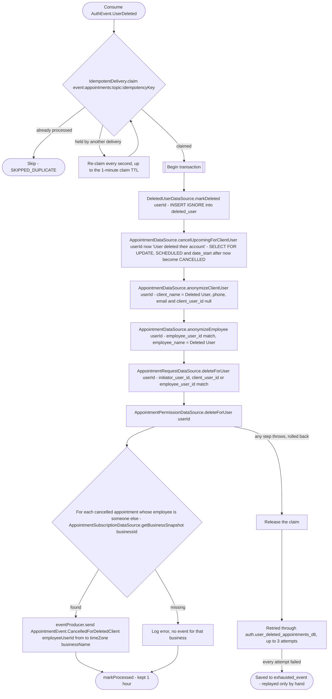

# React to user deletion

Kafka topic `AuthEvent.UserDeleted` → `AppointmentEventHandler` → `DeleteUserAppointmentData`

Produced by [Delete account](../authorization/delete-account.md). Strips
this user's appointment footprint in every role, in one transaction:

- **As the client** (`client_user_id`, the client's own account recorded
  at booking): their upcoming scheduled appointments are cancelled with the
  reason "User deleted their account", freeing the slots, and the employee
  of each one is told through `AppointmentEvent.CancelledForDeletedClient`
  (no client name or address: it is sent after the erasure), unless that
  employee is the deleted user themselves, booked at their own business. Every one of
  their appointments then has its client name, phone, email and
  `client_user_id` cleared, and the rows, their `client_id` and the
  scheduling history stay for the business.
- **As the employee** (`employee_user_id`): the employee name on the
  appointments they worked becomes "Deleted User".
- **Requests** they booked, are the client of, or were assigned are
  deleted, and so are their permission grants.

Recording the user in `deleted_user` comes first, then cancelling, which is
the only locking read on appointments (`SELECT … FOR UPDATE`).

Erasing by `client_user_id` finds every row only if that column is
complete. Appointments booked for a client without an account get it later:
when business gives the row an account, [React to a client getting an
account](on-client-linked.md) fills it in. That event can arrive after this one, so it checks
`deleted_user` and erases the rows it links instead. Bookings check it too
and reject a deleted account. The record holds only the user id and the
time of the first deletion: it is inserted once and never updated, so a
repeated erasure (a link for an account already gone) neither changes it
nor takes an exclusive lock on it.

**Consumed by:** `AppointmentEvent.CancelledForDeletedClient` → [notifications: tell the employee](../notifications/on-appointment-cancelled-for-deleted-client.md).
