# React to user deletion

Kafka topic `AuthEvent.UserDeleted` → `AppointmentEventHandler` → `DeleteUserAppointmentData`

Produced by [Delete account](../authorization/delete-account.md), the [`auth-handleDormantAccounts` job](../scheduled-jobs.md) and, after a backup restore, the [`auth-reapplyErasures` job](../scheduled-jobs.md). Strips
this user's appointment footprint in every role, in one transaction:

- **As the client** (`client_user_id`, the client's own account recorded
  at booking): their upcoming scheduled appointments are cancelled with the
  reason "User deleted their account", freeing the slots, and the employee
  of each one is told through `AppointmentEvent.CancelledForDeletedClient`
  (no client name or address: it is sent after the erasure), unless that
  employee is the deleted user themselves, booked at their own business. Every one of
  their appointments then has its client name, phone, email and
  `client_user_id` cleared, and the rows, their `client_id` and the
  scheduling history stay for the business.
- **As the employee** (`employee_user_id`, indexed): their upcoming
  scheduled appointments are cancelled with the reason "Employee deleted
  their account", and a client with an account is told through
  `AppointmentEvent.Cancelled`. This is a stopgap until such appointments
  can be reassigned to another employee (#137). The employee name on every
  appointment they worked is cleared (it reads as "Deleted User") and its
  `employee_user_id` becomes the nil UUID, so nothing points to their
  account. An appointment they
  booked with themselves is cancelled with the client reason and notifies
  nobody.
- **As the initiator** (`initiator_user_id`, who booked): appointments
  they booked for someone else keep the booking but get the nil UUID as
  initiator.
- **Requests** where they are the client or were assigned are deleted;
  requests they only booked for someone else get the nil UUID as initiator.
  Their permission grants are deleted.
- **As the owner** (`business_has_appointments.owner_user_id`, indexed):
  every business they own is dropped with the other writes (the
  notifications above read their business snapshots before any write),
  and its appointments, requests,
  settings, working hours, days off and grants go with it by
  `ON DELETE CASCADE`. Appointments doesn't wait for
  `BusinessEvent.Deleted` for this; [React to business
  deletion](on-business-deleted.md) still runs, and covers a business
  created before 0.18.0 whose owner the `appointments-fillBusinessOwners`
  job hasn't filled in yet.

The operation runs in three phases: select, delete, shred. Recording the
user in `deleted_user` comes first. Then every locking read
(`SELECT … FOR UPDATE`): the upcoming appointments in both roles in one
statement, `client_user_id = ? OR employee_user_id = ?`, answered by an
index merge of the two indexes; the client ids of their appointments and
requests; the businesses they own and the client ids under them. Only then
come the plain reads, the upcoming appointments with their services and the
business snapshots for the notifications, then the writes, the
notifications and the shred. A locking read after the first plain read
would meet rows changed since that snapshot and fail with error 1020.

Erasing by `client_user_id` finds every row only if that column is
complete. Appointments booked for a client without an account get it later:
when business gives the row an account, [React to a client getting an
account](on-client-linked.md) fills it in. That event can arrive after this one, so it checks
`deleted_user` and erases the rows it links instead. Bookings check it too
and reject a deleted account. The record holds only the user id and the
time of the first deletion: it is inserted once and never updated, so a
repeated erasure (a link for an account already gone) neither changes it
nor takes an exclusive lock on it.

```mermaid
flowchart TD
    Start([Consume AuthEvent.UserDeleted]) --> Claim{"IdempotentDelivery.claim event:appointments:topic:idempotencyKey"}
    Claim -- already processed --> Skip([Skip - SKIPPED_DUPLICATE])
    Claim -- held by another delivery --> Wait[Re-claim every second, up to the 1-minute claim TTL] --> Claim
    Claim -- claimed --> Tx[[Begin transaction]]
    Tx --> Mark["DeletedUserDataSource.markDeleted userId - INSERT IGNORE into deleted_user"]
    Mark --> Upcoming["AppointmentDataSource.getUpcomingIdsOfUserForUpdate userId now - SELECT id FOR UPDATE by client_user_id OR employee_user_id, SCHEDULED, date_start after now"]
    Upcoming --> ClientIds["AppointmentDataSource and AppointmentRequestDataSource.getClientIdsOfUserForUpdate userId - SELECT client_id FOR UPDATE where client_user_id matches"]
    ClientIds --> OwnedIds["AppointmentSubscriptionDataSource.getBusinessIdsOwnedByForUpdate userId, then getClientIdsForUpdate those businesses - SELECT FOR UPDATE the owned business ids and the client ids of their appointments and requests"]
    OwnedIds --> Load["AppointmentDataSource.getAllByIds upcoming ids - plain read with services, after every lock"]
    Load --> Each{"For each business of an upcoming appointment not booked by the user with themselves - AppointmentSubscriptionDataSource.getBusinessSnapshot businessId"}
    Each -- missing --> Log[Log error, no event for that business]
    Each -- found --> Cancel
    Log --> Cancel
    Cancel["AppointmentDataSource.cancelAll - CANCELLED, reason 'User deleted their account' where the user is the client, 'Employee deleted their account' where the user is only the employee"]
    Cancel --> AnonClient["AppointmentDataSource.anonymizeClientUser userId - client name, phone, email, note and their encrypted columns and client_user_id null, read as Deleted Client, cancellation and price adjustment reasons kept"]
    AnonClient --> AnonEmployee["AppointmentDataSource.anonymizeEmployee userId - employee_user_id match, employee_name and employee_name_encrypted null, read as Deleted User, employee_user_id = nil UUID"]
    AnonEmployee --> Unlink["AppointmentDataSource.unlinkInitiator userId - initiator_user_id match set to the nil UUID"]
    Unlink --> DelReq["AppointmentRequestDataSource.deleteForUser userId - deletes rows where client_user_id or employee_user_id match, sets initiator_user_id to the nil UUID on requests they only booked"]
    DelReq --> DelPerm[AppointmentPermissionDataSource.deleteForUser userId]
    DelPerm --> Owned["AppointmentSubscriptionDataSource.detachBusinesses owned business ids - DELETE business_has_appointments, everything under it by ON DELETE CASCADE"]
    Owned --> Notify{"For each cancelled appointment with a known business, not booked by the user with themselves - was the user its client?"}
    Notify -- yes --> Send["eventProducer.send AppointmentEvent.CancelledForDeletedClient employeeUserId from to timeZone businessName"]
    Notify -- "no, its employee" --> HasAccount{client.userId set?}
    HasAccount -- yes --> SendClient["eventProducer.send AppointmentEvent.Cancelled clientUserId reason 'Employee deleted their account'"]
    Send --> Shred
    SendClient --> Shred
    HasAccount -- no --> Shred
    Shred["SubjectKeys.shredAll userId, the client ids of their appointments and requests, and the clients of the dropped businesses"]
    Shred --> Processed([markProcessed - kept 1 hour])
    Shred -- any step throws, rolled back --> Release[Release the claim] --> Dlt["Retried through auth.user_deleted_appointments_dlt, up to 3 attempts"]
    Dlt -- every attempt failed --> Parked(["Saved to exhausted_event - EventsExhausted alert, replayed on the next start or when replay_requested is set"])
```

**Consumed by:** `AppointmentEvent.CancelledForDeletedClient` → [notifications: tell the employee](../notifications/on-appointment-cancelled-for-deleted-client.md); `AppointmentEvent.Cancelled` → [notifications: tell the client](../notifications/on-appointment-cancelled.md).
