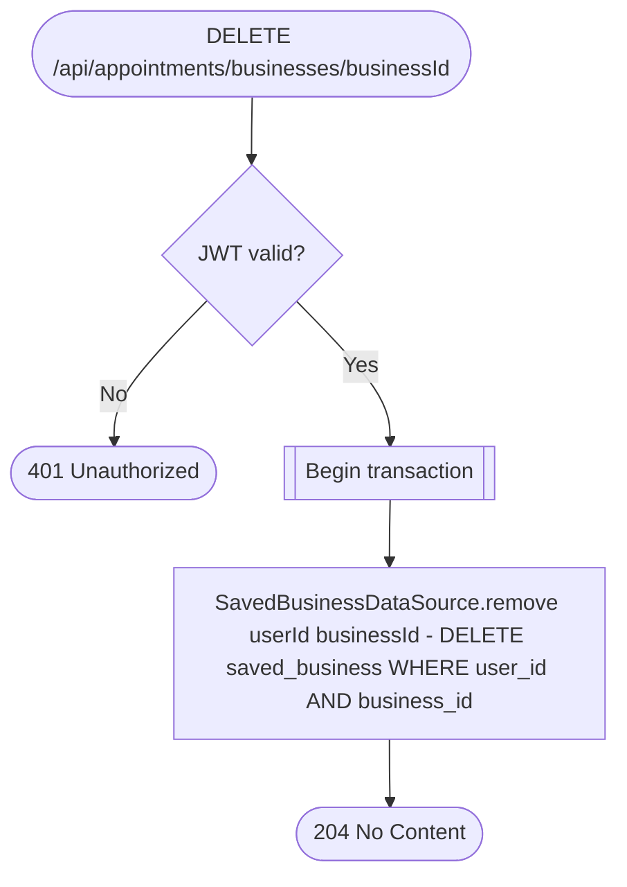

# Remove saved business

`DELETE /api/appointments/businesses/{businessId}` → `RemoveSavedBusiness`

A client removes a business from their saved businesses (see [Save
business](save-business.md)), which frees a place under the limit of 100.
Removing a business that isn't saved changes nothing. The delete matches the
caller's own user id and the business id, so nobody can reach another
user's list. No event is sent.

