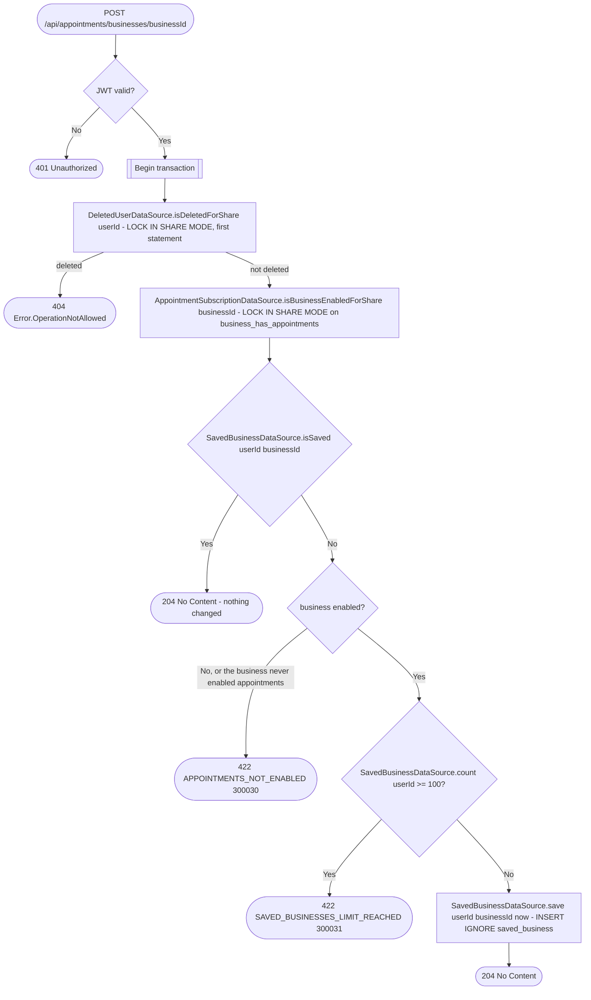

# Save business

`POST /api/appointments/businesses/{businessId}` → `SaveBusiness`

A client adds a business to their saved businesses, typically when they open
the business's link in the Telegram Mini App, so its Home screen can offer it
for booking again (`GET /api/appointments/businesses`). Only a business that
takes appointments right now can be saved; saving one already saved changes
nothing, whatever its state. A user can save at most 100 businesses
(`SaveBusiness.MAX_SAVED_BUSINESSES`), a soft cap: saves by one user aren't
serialized, so two at the same moment can end one over it (the developer's
decision, to avoid a per-user lock row); removing one (see [Remove saved
business](remove-saved-business.md)) frees a place.

The account tombstone is read first with a shared lock, like the booking
paths, so a save racing account deletion either lands before it and is
deleted by it, or sees the deletion and answers 404. Then the business's
`business_has_appointments` row is read with a shared lock, so the business
can't be erased between the check and the insert (which would fail on the
foreign key with a 500). Every plain read comes after these locks; a business
already saved is a no-op even if it stopped taking appointments, and the
insert is an `INSERT IGNORE`, so two concurrent saves of the same business
keep one row with the first time. No event is
sent.

