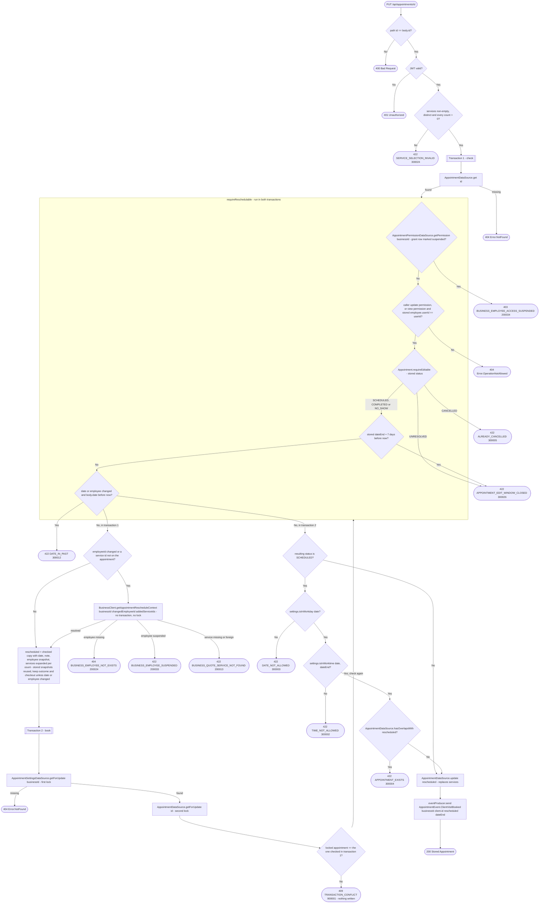

# Update appointment (reschedule)

`PUT /api/appointments/{id}` → `UpdateAppointment`

Edits a `SCHEDULED`, `COMPLETED` or `NO_SHOW` appointment within its 7-day
edit window — date, note, assigned employee and services. `CANCELLED` is
terminal; staff must create a new appointment rather than restore it.
`UNRESOLVED` is immutable and returns `APPOINTMENT_EDIT_WINDOW_CLOSED` (300026).
The body (`AppointmentUpdate`) carries only ids: `employeeId` and
`services` as `RequestedService(serviceId, count)`. No name, contact or price
is ever taken from the client:

- the **client** and **business** always stay those of the stored
  appointment — an update can neither swap the client nor move the
  appointment into another business;
- an **unchanged employee** keeps the stored `EmployeeSnapshot`; a new one is
  resolved from the business service;
- a **service already on the appointment** keeps its stored `ServiceSnapshot`,
  including its price, so rescheduling never silently re-prices a booking;
  only **newly added** services are resolved from the catalog.

When nothing needs resolving (a plain date/note change) no call leaves the
service. Otherwise one call, `BusinessClient.getAppointmentRescheduleContext`
(`POST /api/internal/business/{id}/appointment-reschedule-context`), resolves
the changed employee and the added services together. Unlike the booking
context it never resolves or creates a client.

Changing the date or assigned employee reopens an eligible appointment as
`SCHEDULED`, clears `completedBy` and removes its previous checkout adjustment
and additional checkout services. Edits that keep the date and employee preserve
the recorded status, completion attribution and checkout, even when the original
date is in the past. A changed time or employee must use a future date. Other status changes happen through [Cancel appointment](cancel-appointment.md),
[Complete appointment](complete-appointment.md) and [Mark appointment as
no-show](mark-appointment-no-show.md), or the `MarkAppointmentsCompleted`
job. The response is the stored appointment, not an echo of the body.

It runs in two transactions, so that no lock is held during the call to
business and the booking transaction still takes its locks before its first
plain read:

1. **Check.** A short transaction reads the appointment
   (`AppointmentDataSource.get`), checks the caller's permission, that it is
   still eligible (`Appointment.requireEditable()`) and that a changed date or
   employee does not move the booking into the past. The appointment is fetched before the permission check
   so a `view`-only employee can be let through when it's their own — see
   [Managing your own resource on a `view`
   grant](../../object-permissions.md#managing-your-own-resource-on-a-view-grant).
   The change is then resolved from business, outside any transaction.
2. **Book.** The settings row is locked first
   (`AppointmentSettingsDataSource.getForUpdate`), then the appointment row
   (`getForUpdate`). If the locked appointment differs from the one checked
   in step 1 (a cancel, completion, no-show, job run or another reschedule
   committed in between), nothing is written and the route answers 409
   `TRANSACTION_CONFLICT`, so the app retries with fresh data. Otherwise the
   permission, status and date are checked again, now that the snapshot is
   taken after both locks. A resulting `SCHEDULED` booking is checked for workday,
   worktime and overlaps. Historical corrections that preserve `COMPLETED` or
   `NO_SHOW` reserve no slot and skip those booking checks. The appointment is
   then written.

The settings lock serializes every booking write of the business and is the
double-booking guard — the `(user_id, business_id, date_start)` index is
deliberately non-unique so a cancelled appointment doesn't block its slot.
Before this order, the permission was read before the settings lock, so a
reschedule that waited behind another booking checked overlaps against a
snapshot from before that booking committed and could take the same slot.
Lock order settings → appointment can't deadlock with the other writers: a
cancel, completion or no-show locks only the appointment, and approving a
request locks the request, then the settings. Nothing is written until every
validation has passed.

**Consumed by:** `AppointmentEvent.ClientVisitBooked` → [business: record the client's
visit](../business/on-client-visit-booked.md).
