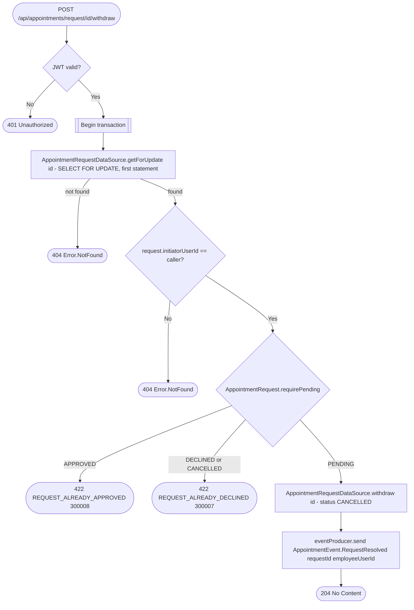

# Withdraw appointment request

`POST /api/appointments/request/{id}/withdraw` → `WithdrawAppointmentRequest`

The person who made a booking request takes it back while the business hasn't
answered it yet. The request is marked `CANCELLED`, the same status the hourly
`appointments-deleteOutdatedRequests` job gives a request whose slot has
passed, so it leaves the business's pending list and stops counting toward the
business's limit of pending requests per client (see [Create appointment
request](create-appointment-request.md)). Only the initiator
(`initiator_user_id`) can withdraw; for anyone else, or an unknown id, the
answer is 404, so the route doesn't reveal which ids exist. The request row is
locked first, so a withdrawal and the business's approval or decline can't both
succeed. Nobody is notified, but `AppointmentEvent.RequestResolved` tells the
assigned employee's devices to remove the request's push.

**Consumed by:** `AppointmentEvent.RequestResolved` → [notifications: data-only push to the employee](../notifications/on-appointment-request-resolved.md).
