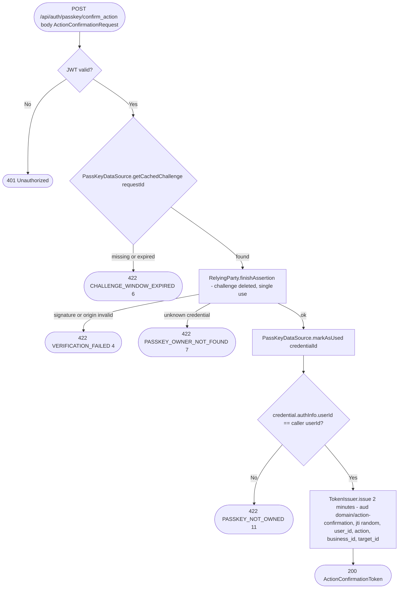

# Confirm a sensitive action with a passkey

`POST /api/auth/passkey/confirm_action` → `ConfirmAction`

A signed-in user proves, with a fresh passkey assertion, that they hold one
of their own passkeys right now, for one action on one target. Auth answers
with an action confirmation token that the protected operation checks before doing the action.
The actions are `ConfirmableAction.DELETE_CLIENT` ([Delete
client](../business/delete-client.md)), `EXPORT_PERSONAL_DATA`,
`EXPORT_BUSINESS_DATA` (the data exports of #139), and `DELETE_ACCOUNT`
([Delete account](delete-account.md), claim `account.delete`, enum
`@ProtoNumber(3)`). For a personal data export or account deletion the app
sends `businessId` = the nil UUID and `targetId` = the caller's own user id;
for a business data export, the business id as both.

The app's flow:

1. `GET /api/auth/passkey/sign_in/challenge` for a challenge (`requestId` plus WebAuthn options).
2. Ask the platform for an assertion with those options.
3. `POST /api/auth/passkey/confirm_action` with the `requestId`, the assertion JSON, the action, the business id and the target id.
4. Send the returned token with the action's request, for example `DeleteAccountRequest(confirmationToken)` to `DELETE /api/auth/account` or the body of `DELETE /api/business/{businessId}/clients/{id}`. Keep the access token on both authenticated requests.

The token is a JWT signed with auth's keys (published at auth's JWKS), valid
for 2 minutes, with its own audience (`<domain>/action-confirmation`, `TokenAudience.actionConfirmation`).
An access token's audience is the bare domain, so neither is accepted where
the other is expected. Its claims bind it to the caller (`user_id`), the
action (`action`, `ActionConfirmationClaims.ACTION_DELETE_CLIENT` = `client.delete`), the
business (`business_id`) and the target (`target_id`), and its `jti` is
unique. The service that checks it spends the `jti` once.

The passkey must belong to the caller (`FinishAssertion.finishOwnedBy`). The
sign-in challenge names no user, so without that check any valid passkey of
any account would pass.

