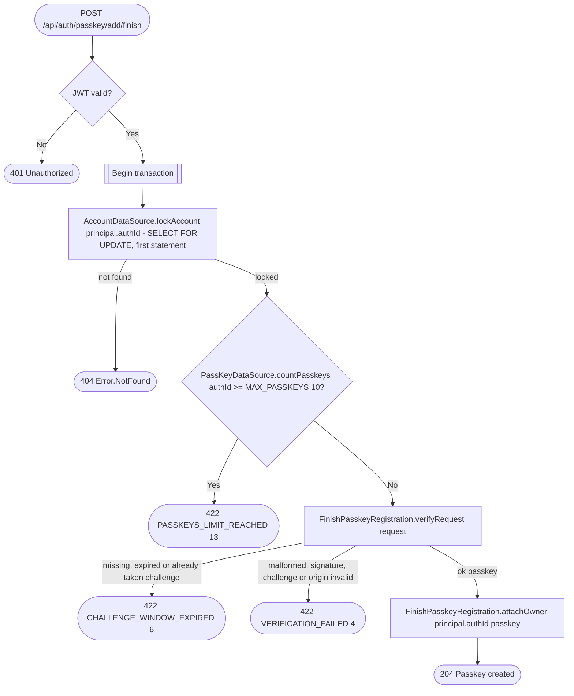

# Add passkey to account

`POST /api/auth/passkey/add/finish` → `AttachNewPasskeyToAccount`

Second step after `GET /api/auth/passkey/add/challenge`: verifies the
signed challenge and attaches the resulting credential to the currently
authenticated auth record, giving the account another sign-in method.
An account holds at most 10 passkeys (`AttachNewPasskeyToAccount.MAX_PASSKEYS`,
the same for everyone). The account row is locked first, so two additions
can't both take the last slot. The challenge step refuses an account that is
already full with the same `PASSKEYS_LIMIT_REACHED`, before the device asks
the user to create a passkey.

