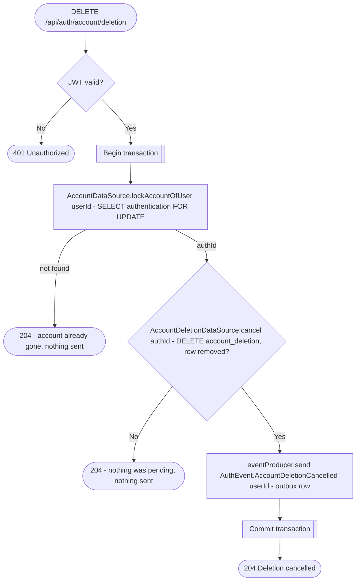

# Cancel account deletion

`DELETE /api/auth/account/deletion` → `CancelAccountDeletion`

Requires only an access token: cancelling keeps data instead of destroying it,
so no passkey confirmation is asked for, and accounts without a passkey (created
through Telegram) can cancel too. Removes the caller's pending
`account_deletion` row, written by [Delete account](delete-account.md), and
sends `AuthEvent.AccountDeletionCancelled` so the user is told, which also
warns them if someone else cancelled with their session. Answers 204 whether or
not a deletion was pending; nothing is sent when none was, or when the account
is already gone.

The transaction locks the caller's `authentication` row first
(`AccountDataSource.lockAccountOfUser`), the row the
[`auth-handleScheduledDeletions` job](../scheduled-jobs.md) also locks before it
erases, so a cancel that arrives while the job runs either removes the row
before the job reads it or waits and finds the account erased.

`GET /api/auth/account/deletion` (`GetAccountDeletion`) reads the pending date
without a lock and answers 200 with `AccountDeletionStatus(deletesAt)`, empty
when none is pending.

**Consumed by:** `AuthEvent.AccountDeletionCancelled` →
[notifications: tell the user the deletion was cancelled](../notifications/on-account-deletion-cancelled.md).
