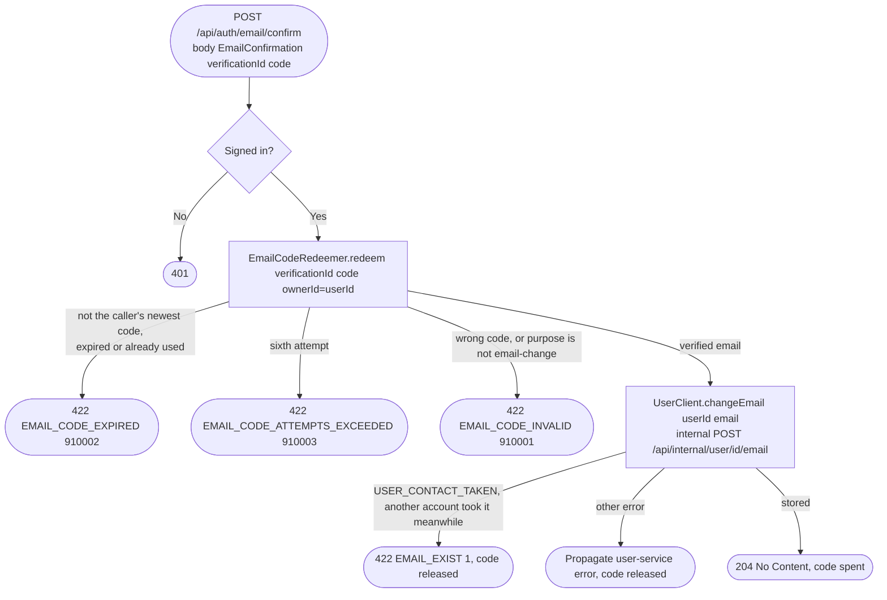

# Confirm an email change

`POST /api/auth/email/confirm` → `ConfirmEmailChange`

Checks the code from [Request an email change code](start-email-change.md)
against the caller's newest email change and stores the address it was
sent to through the user service. The address comes from the code's
session, never from the body. If the user service refuses the address, the
code is released and can be used again.

The user service stores the address and sends `UserEvent.Updated` in one
transaction ([Store a verified email](../user/change-user-email-internal.md)).

**Consumed by:** `UserEvent.Updated` → [business: sync denormalized client/
employee copies](../business/on-user-updated.md) and [notifications: sync
the email delivery target](../notifications/on-user-updated.md).
