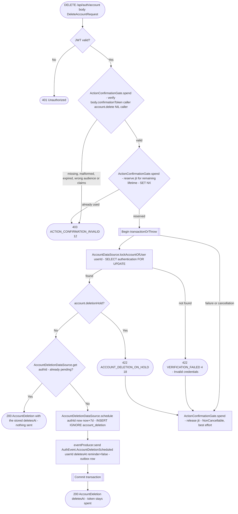

# Delete account

`DELETE /api/auth/account` → `DeleteAccount`

Requires an access token and `DeleteAccountRequest(confirmationToken)`. Get the
action confirmation token from [Confirm a sensitive action with a passkey](action-confirmation.md)
with `ConfirmableAction.DELETE_ACCOUNT`, `businessId` = the nil UUID and
`targetId` = the caller's own user id. Issuance verifies a fresh assertion
of one of the caller's own passkeys (`FinishAssertion.finishOwnedBy`).
Before 0.17.0 deletion accepted any account's passkey.

Since 0.21.0 the route schedules the deletion instead of erasing at once.
It stores an `account_deletion` row due 7 days later (`DeleteAccountImpl.GRACE_PERIOD`),
sends `AuthEvent.AccountDeletionScheduled` (`reminder = false`) so the user is told
at once, and answers 200 with `AccountDeletion(deletesAt)`. The account keeps
working normally until then: sign-in, bookings and businesses are untouched, and
signing in does not cancel it. The user cancels with
[Cancel account deletion](cancel-account-deletion.md), reads the date with
`GET /api/auth/account/deletion`, and the
[`auth-handleScheduledDeletions` job](../scheduled-jobs.md) sends the 2-day and
1-day reminders and erases the account when it is due. Asking again while a
deletion is pending returns the stored date and sends nothing, but still spends
the token.

`ActionConfirmationGate.spend` verifies the signature, action confirmation audience, expiry and all
four claims against `ActionConfirmationGrant.accountDeletion(userId)`, then reserves the
`jti` once in Valkey (`SET NX action_confirmation:<jti>` until expiry) before opening the
transaction. Missing, malformed, expired, used or mismatched tokens
get 403 `ACTION_CONFIRMATION_INVALID` (12), with no database work. A missing body, an
omitted token or the old passkey assertion body gets the same error. The new
field uses `@ProtoNumber(3)`; the old fields 1 and 2 are not reused.

The transaction locks the caller's `authentication` row first
(`AccountDataSource.lockAccountOfUser`), the same row the cancel route and the
job lock first, so a request, a cancel and an erasure of one account never
interleave. A successful request keeps the token spent. A failure or
cancellation releases its reservation under `NonCancellable`, best effort, so
the same token can be retried while it remains valid.

An account on `deletion_hold` (set by staff for a restriction or legal hold)
can't be scheduled: the request answers 422 `ACCOUNT_DELETION_ON_HOLD` (18),
stores nothing, sends nothing and releases the token. A hold set after the
request leaves the pending row in place but the job neither reminds nor erases
until it is lifted. Database conflict retries
rerun only the transaction, without spending the token again or consuming
another passkey challenge.

The erasure itself, run by the job through `AccountEraser`, is unchanged: it is
recorded in `authorization.erased_account` in the erasing transaction, so a
backup restore to an earlier point can erase the account again
([Restoring prod](../../../deployment/ansible/README.md#restoring-prod)), and
writes `AuthEvent.UserDeleted` and one `AuthEvent.DeviceDeleted` per device to
the outbox before removing the auth record, which cascades to its passkeys,
devices and the `account_deletion` row. A restore to a point before the request
loses the pending deletion; the user has to ask again.

**Consumed by:** `AuthEvent.AccountDeletionScheduled` →
[notifications: tell the user when the account will be deleted](../notifications/on-account-deletion-scheduled.md).
When the job erases the account, `AuthEvent.UserDeleted` fans out to four services —
[appointments](../appointments/on-user-deleted.md),
[business](../business/on-user-deleted.md),
[notifications](../notifications/on-user-deleted.md), and
[user](../user/on-user-deleted.md) (the actual profile delete) — run
independently and in no guaranteed order relative to each other or to the
job's own `deleteAuthorization` write. `AuthEvent.DeviceDeleted` (one per
device) → [notifications: remove the device's push-token
row](../notifications/on-device-deleted.md).
