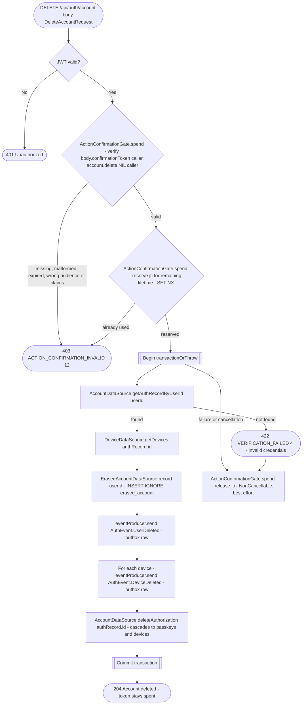

# Delete account

`DELETE /api/auth/account` → `DeleteAccount`

Requires an access token and `DeleteAccountRequest(confirmationToken)`. Get the
action confirmation token from [Confirm a sensitive action with a passkey](action-confirmation.md)
with `ConfirmableAction.DELETE_ACCOUNT`, `businessId` = the nil UUID and
`targetId` = the caller's own user id. Issuance verifies a fresh assertion
of one of the caller's own passkeys (`FinishAssertion.finishOwnedBy`).
Before 0.17.0 deletion accepted any account's passkey.

`ActionConfirmationGate.spend` verifies the signature, action confirmation audience, expiry and all
four claims against `ActionConfirmationGrant.accountDeletion(userId)`, then reserves the
`jti` once in Valkey (`SET NX action_confirmation:<jti>` until expiry) before opening the
deletion transaction. Missing, malformed, expired, used or mismatched tokens
get 403 `ACTION_CONFIRMATION_INVALID` (12), with no database work. A missing body, an
omitted token or the old passkey assertion body gets the same error. The new
field uses `@ProtoNumber(3)`; the old fields 1 and 2 are not reused.

The erasure is recorded in `authorization.erased_account` in the same
transaction, so a backup restore to an earlier point can erase the account
again ([Restoring prod](../../../deployment/ansible/README.md#restoring-prod)).
`AccountEraser` writes `AuthEvent.UserDeleted` and one `AuthEvent.DeviceDeleted`
per device to the outbox before removing the auth record, which cascades to
its passkeys and devices. A successful deletion keeps the token spent. A
failure or cancellation releases its reservation under `NonCancellable`,
best effort, so the same token can be retried while it remains valid.
Database conflict retries rerun only the transaction, without spending the
token again or consuming another passkey challenge.

**Consumed by:** `AuthEvent.UserDeleted` fans out to four services —
[appointments](../appointments/on-user-deleted.md),
[business](../business/on-user-deleted.md),
[notifications](../notifications/on-user-deleted.md), and
[user](../user/on-user-deleted.md) (the actual profile delete) — run
independently and in no guaranteed order relative to each other or to this
route's own `deleteAuthorization` write. `AuthEvent.DeviceDeleted` (one per
device) → [notifications: remove the device's push-token
row](../notifications/on-device-deleted.md).
