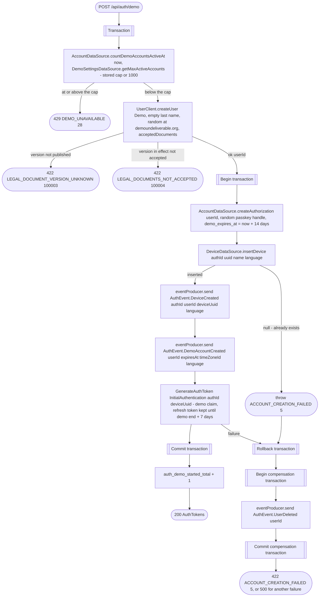

# Start a demo account

`POST /api/auth/demo` → `StartDemo`

Creates a 14-day demo account without signing up, like a Telegram sign-in
creates an account: a placeholder user, the `authentication` row and the
device, signed in with normal tokens. The account is a demo because
`authentication.demo_expires_at` is set (now + 14 days); its access tokens
carry the `demo` claim, and the refresh is refused from that date on
([Refresh access token](refresh-token.md)). The user is named `Demo` and gets
the placeholder email `<random hex>@demoundeliverable.org`, which no email is
ever sent to and which sign-up and email change refuse. The device's refresh
token is the only credential until the [upgrade](demo-upgrade.md).

Creation is anonymous, so it is limited twice: nginx's `auth_demo` zone allows
one start a minute from one address (bursts of 3), and auth refuses a new demo
while as many demos are unexpired as `authorization.demo_settings.max_active_accounts`
allows (`NULL` or no row: `DemoAccountPolicy.DEFAULT_MAX_ACTIVE_ACCOUNTS`, 1000;
`0` turns demos off). The cap is read on every request, so an operator's change
applies at once. The count is not serialized, so concurrent starts can end a
few over the cap.

**Consumed by:** `AuthEvent.DemoAccountCreated` → [business: seed the sample
business](../business/on-demo-account-created.md); `AuthEvent.DeviceCreated` →
[notifications: mirror the new device](../notifications/on-device-created.md).
