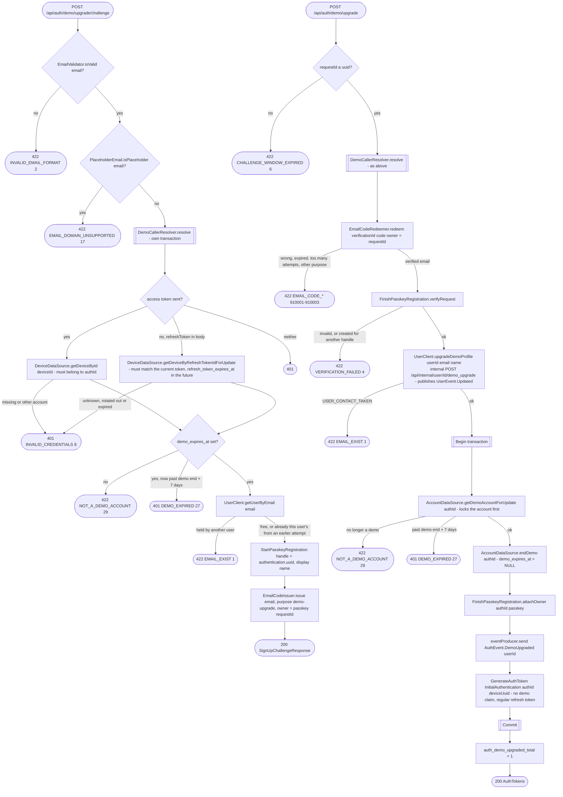

# Upgrade a demo account

`POST /api/auth/demo/upgrade/challenge` → `StartDemoUpgrade`, then
`POST /api/auth/demo/upgrade` → `FinishDemoUpgrade`

Turns a [demo account](demo-start.md) into a regular one that keeps all its
data: the user adds a verified email and a passkey, the placeholder email and
name are replaced, and `authentication.demo_expires_at` is cleared. Both steps
identify the caller the same way (`DemoCallerResolver`, its own transaction):
by the access token while the demo runs (`authenticate(optional = true)`), or,
with no `Authorization` header, by the device's current refresh token in the
body. The refresh token is what keeps the upgrade possible for 7 days after the
demo ended (`DemoAccountPolicy.UPGRADE_GRACE_PERIOD`), when refresh already
answers `DEMO_EXPIRED`; it is only checked, never rotated here. A refresh
token that was rotated out does not count.

The passkey is created for the demo account's own handle (`authentication.uuid`),
so it signs in to this account later. The code email reuses the sign-up text
with its own purpose (`demo-upgrade`), so a sign-up or email change code can't
finish an upgrade.

The profile is stored before the transaction, since it is a call to another
service ([Replace a demo profile](../user/upgrade-demo-profile-internal.md)). When the transaction then fails, the account keeps the real email
and stays a demo; the next attempt may use that same email, which the start
step accepts because it already belongs to this user.

**Consumed by:** `AuthEvent.DemoUpgraded` → [business: clear the demo
flag and limits](../business/on-demo-upgraded.md).
