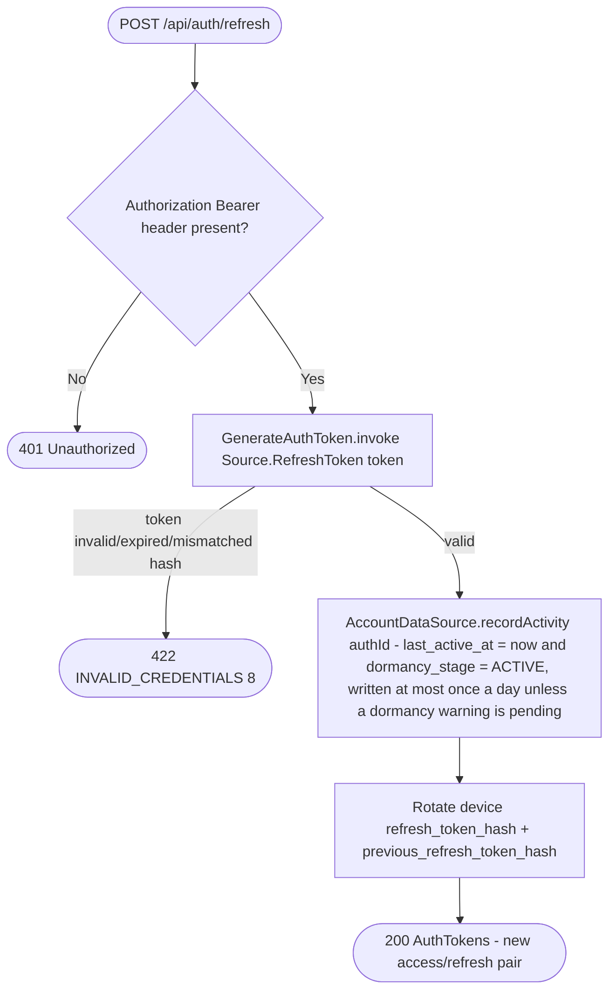

# Refresh access token

`POST /api/auth/refresh` (header `Authorization: Bearer <refresh token>`) → `RefreshToken`

Rotates the access/refresh pair for a device. The `Authorization` header is
read directly by the route (not through `AppPrincipal`, since the access
token has typically expired); `GenerateAuthToken` validates the refresh
token against the device's stored hash and issues a new pair.

Refreshing counts as activity for [dormant-account deletion](../scheduled-jobs.md)
(`auth-handleDormantAccounts`): the app refreshes almost every time it opens,
since access tokens live 5 minutes. Sign-in records it too, through the
same `GenerateAuthToken`, which matters because refresh tokens expire and
inactive devices are deleted after 30 days.
