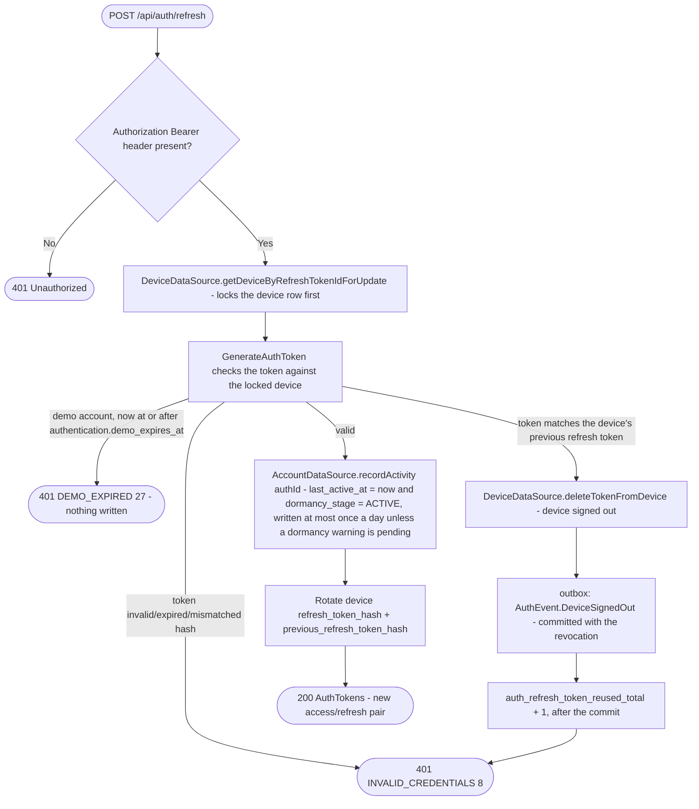

# Refresh access token

`POST /api/auth/refresh` (header `Authorization: Bearer <refresh token>`) → `RefreshToken`

Rotates the access/refresh pair for a device. The `Authorization` header is
read directly by the route (not through `AppPrincipal`, since the access
token has typically expired); `GenerateAuthToken` validates the refresh
token against the device's stored hash and issues a new pair.

A demo account (`authentication.demo_expires_at` set) refreshes like any
other until its demo ends, with three differences: its access token carries
the `demo` claim and expires no later than the demo, its refresh token is
stored with `refresh_token_expires_at` = the demo's end + 7 days (so the
[demo upgrade](demo-upgrade.md) can still find the device in the grace
period), and from the demo's end on the refresh answers `DEMO_EXPIRED`
without rotating anything.

Refreshing counts as activity for [dormant-account deletion](../scheduled-jobs.md)
(`auth-handleDormantAccounts`): the app refreshes almost every time it opens,
since access tokens live 5 minutes. Sign-in records it too, through the
same `GenerateAuthToken`, which matters because refresh tokens expire and
inactive devices are deleted after 30 days.

A refresh token that was already exchanged and comes back is what a stolen
token looks like, so its device is signed out: the transaction commits the
revocation and returns, and the operation fails with `INVALID_CREDENTIALS`
only after the commit (throwing inside the transaction would roll the
revocation back). The revocation sends `AuthEvent.DeviceSignedOut` like
[Sign out](sign-out.md), so the device also stops receiving pushes. The
counter feeds the `RefreshTokenReused` alert.

The device row is locked as the transaction's first statement, so two
refreshes of one device run one after the other; the app refreshes under a
mutex, so a second refresh with the same token is never a client race.
