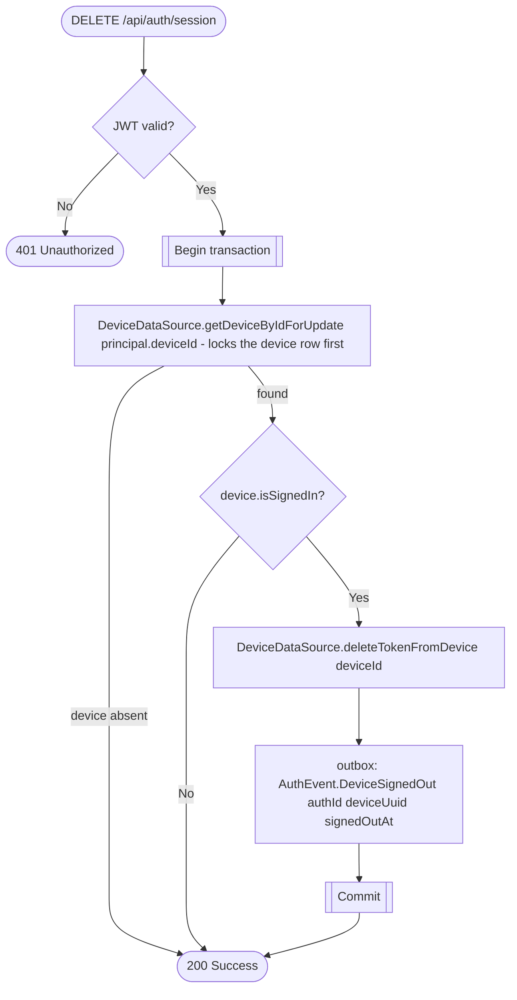

# Sign out

`DELETE /api/auth/session` → `SignOut`

Clears the calling device's stored refresh token so it can no longer mint
new access tokens; the device row itself is kept. It also announces the
sign-out, so notifications stops sending pushes to the device (see
[React to device sign-out](../notifications/on-device-signed-out.md)). A
device that no longer exists (deleted after 30 days of inactivity) answers
success and announces nothing, and so does a device that is already signed
out, so a retried sign-out can't clear a push token registered in between.
Only the device row is locked, not the account, so signing out doesn't wait
on sign-ins or refreshes on the account's other devices.

