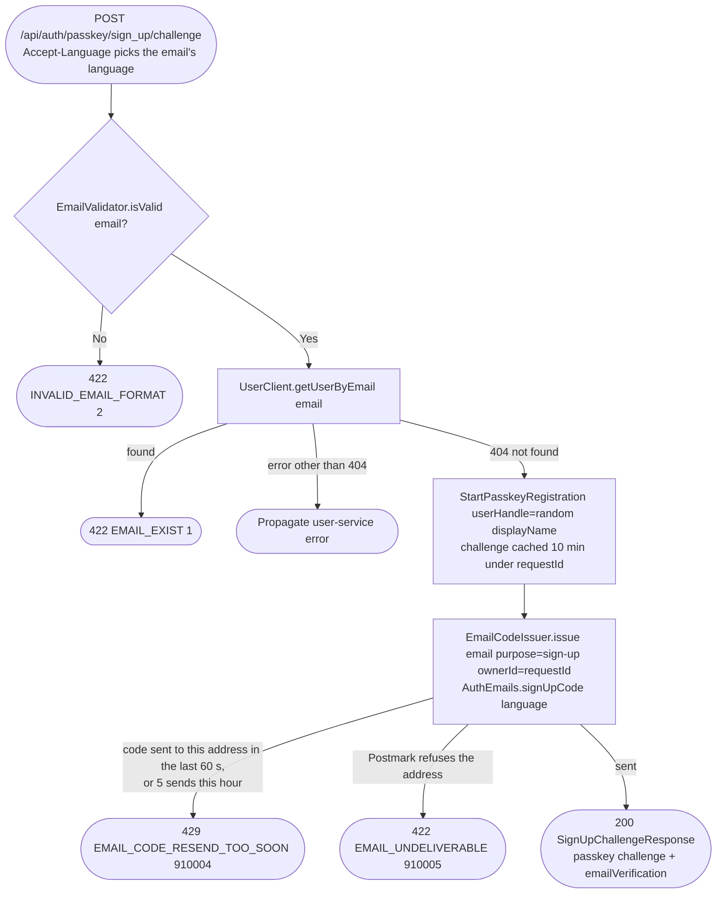

# Get sign-up challenge

`POST /api/auth/passkey/sign_up/challenge` → `StartRegistration`

The first step of registration: validates the email, confirms no user
already owns it (via the user service), asks the WebAuthn layer for a
passkey creation challenge, and emails a 6-digit code to the address. The
code is bound to this challenge (its owner is the challenge's `requestId`)
and lives 10 minutes, as long as the challenge. No account row exists yet:
that only happens once [Verify sign-up](sign-up.md) has checked both the
code and the signed challenge, so every account's email is verified from
the start. Calling it again restarts sign-up with a new challenge and a new
code, subject to the code's resend limits.

