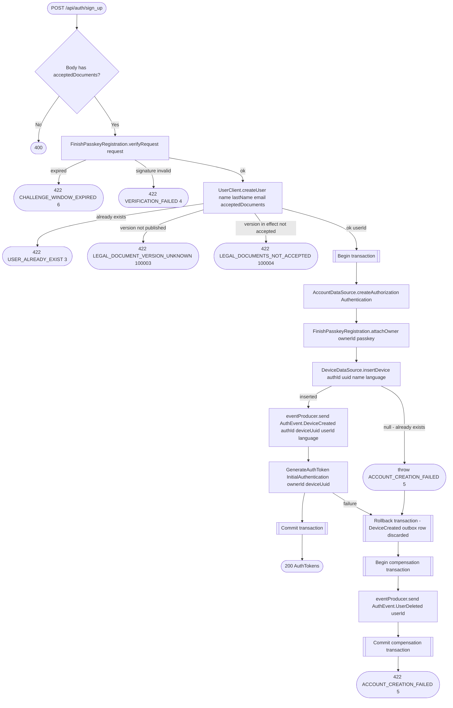

# Verify sign-up (create account)

`POST /api/auth/sign_up` → `FinishRegistration`

Verifies the signed WebAuthn challenge from [Get sign-up
challenge](sign-up-challenge.md), then creates the user (in the user
service, through [Create user (internal)](../user/create-user-internal.md),
which also records the legal document versions the app sent in
`acceptedDocuments`. The field is required: an older app that sends none
gets 400. It must name the version in effect of every published document,
otherwise the user service answers 422 `LEGAL_DOCUMENTS_NOT_ACCEPTED`
(100004), or `LEGAL_DOCUMENT_VERSION_UNKNOWN` (100003) for a version that
isn't published or in effect, and nothing is created), the local `Authentication` record, the passkey credential, the
first device, and the initial token pair — all inside one transaction. If
anything inside the transaction fails, the local device and its `DeviceCreated` outbox row roll back together. The already-created remote user is removed through a compensating `UserDeleted` event rather than a distributed transaction. Events go through the
[transactional outbox](../../transactional-outbox.md), which only accepts a
send inside a transaction, so the compensating events are stored in a
transaction of their own, opened after the failed one has rolled back.

**Consumed by:** `AuthEvent.DeviceCreated` → [notifications: mirror the new
device](../notifications/on-device-created.md). The compensating `AuthEvent.UserDeleted` sent on failure fans out to [user](../user/on-user-deleted.md), [business](../business/on-user-deleted.md), [appointments](../appointments/on-user-deleted.md) and [notifications](../notifications/on-user-deleted.md), as for [Delete account](delete-account.md), even though no account ever successfully existed here. No device-deletion event is sent on failure: the device insert and creation event never committed, and cleanup by installation UUID could affect another account.
