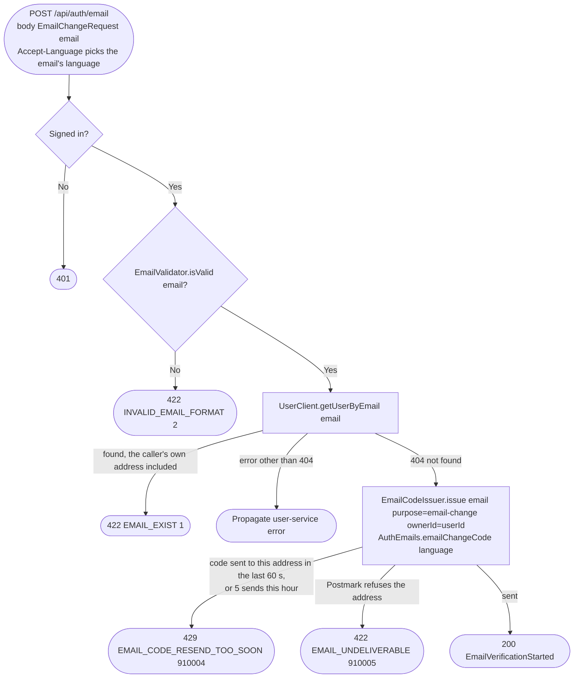

# Request an email change code

`POST /api/auth/email` → `StartEmailChange`

A signed-in user asks to move their account to a new address. Auth checks
the address is well formed and free, then emails a 6-digit code to it,
valid 10 minutes. Nothing is stored yet: the address changes only through
[Confirm an email change](confirm-email-change.md). The code's owner is
the caller's `userId`, and only their newest code works.

