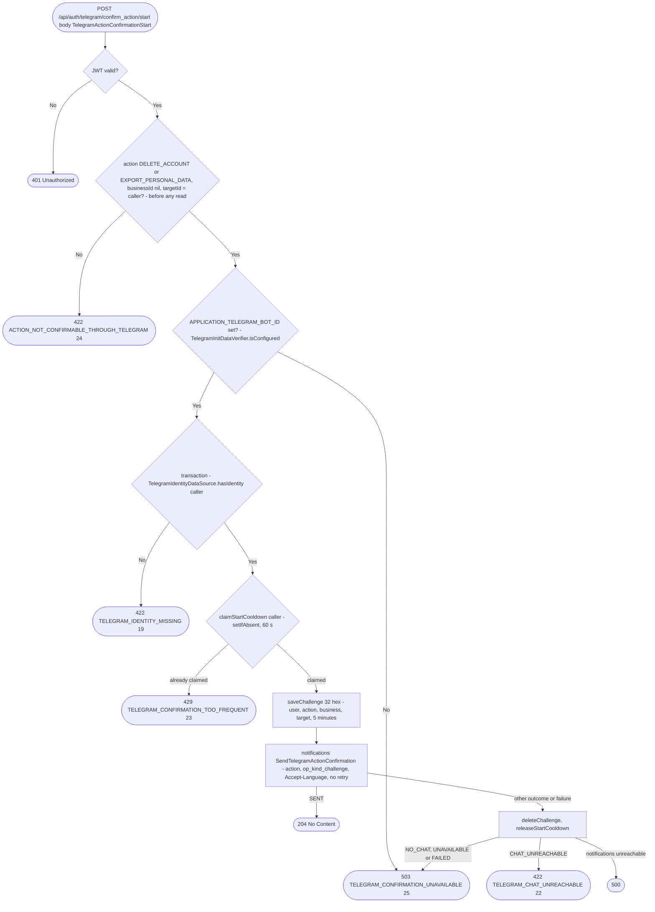

# Start confirming an action through Telegram

`POST /api/auth/telegram/confirm_action/start` → `StartTelegramActionConfirmation`

The Mini App can't use a passkey (no WebAuthn in Telegram's in-app browser),
and an account created through Telegram has none, so it can't use [Confirm a
sensitive action with a passkey](action-confirmation.md). Instead, for any
account linked to Telegram, with or without a passkey,
the bot sends the user a one-time link to the Mini App, and the user confirms
from the Mini App that link opens ([Confirm an action through
Telegram](telegram-confirm-action.md)). Only the actions the Mini App offers
qualify: `DELETE_ACCOUNT` and `EXPORT_PERSONAL_DATA`, each with the nil business
id and the caller as target. Client deletion and the business data export stay
passkey-only.

The challenge is 128 random bits as 32 lowercase hex characters, kept in the
cache for 5 minutes with the user id, action, business id and target id
(`TelegramConfirmationDataSource`). The link's `start_param` is
`op_<kind>_<challenge>` ([launch parameters](../../telegram-launch-parameters.md)).
One start a minute per user is claimed with `setIfAbsent`; a failed send gives
the minute and the challenge back. The message goes out through notifications
(`SendTelegramActionConfirmation`, internal route, see [Send a Telegram action
confirmation link](../notifications/send-telegram-action-confirmation.md)),
which holds the Telegram chat id and the bot token; auth keeps only the blind
index of the Telegram user id. No transaction is open while it is sent, and
the call is never retried, so the user never gets the same message twice: a
failed Bot API call comes back as the outcome `FAILED`, not as an error.

