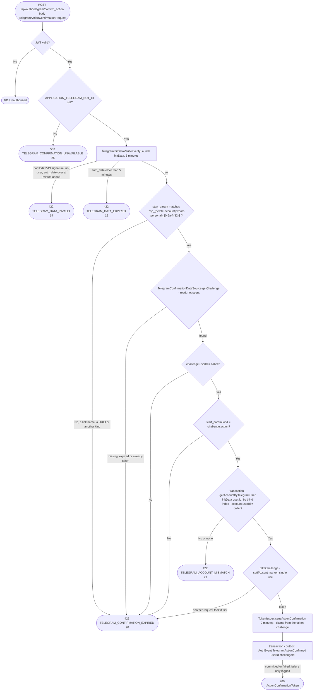

# Confirm an action through Telegram

`POST /api/auth/telegram/confirm_action` → `ConfirmActionWithTelegram`

The second half of [Start confirming an action through
Telegram](telegram-confirm-action-start.md). The user taps the bot's button,
Telegram opens the Mini App with `start_param` = `op_<kind>_<challenge>`, and on
Confirm the Mini App sends the raw `Telegram.WebApp.initData`. `start_param` is
part of the launch data Telegram signs, so a challenge in it proves that this
Telegram account opened that link after the challenge was created. The answer
is the same 2-minute action confirmation token as [the passkey
route](action-confirmation.md), and everything after it
(`ActionConfirmationGate`, the protected operations) is unchanged.

The token's action, business id and target id come only from the stored
challenge, never from the request, so a confirmation started for an export
can't become an account deletion. The checks run in this order. The challenge
is read without being spent while it is checked, and taken atomically only once
every check passed, so a bad launch, another user, or a forwarded button opened
from another Telegram account doesn't spend it. The Telegram account check is
the counterpart of `FinishAssertion.finishOwnedBy`: without it, someone holding
a stolen access token could open the link in their own Telegram.

**Consumed by:** `AuthEvent.TelegramActionConfirmed` → [notifications: mark the
bot's message confirmed](../notifications/on-telegram-action-confirmed.md). The
event only changes the chat message, so a failure to store it is logged and the
token is still returned.
