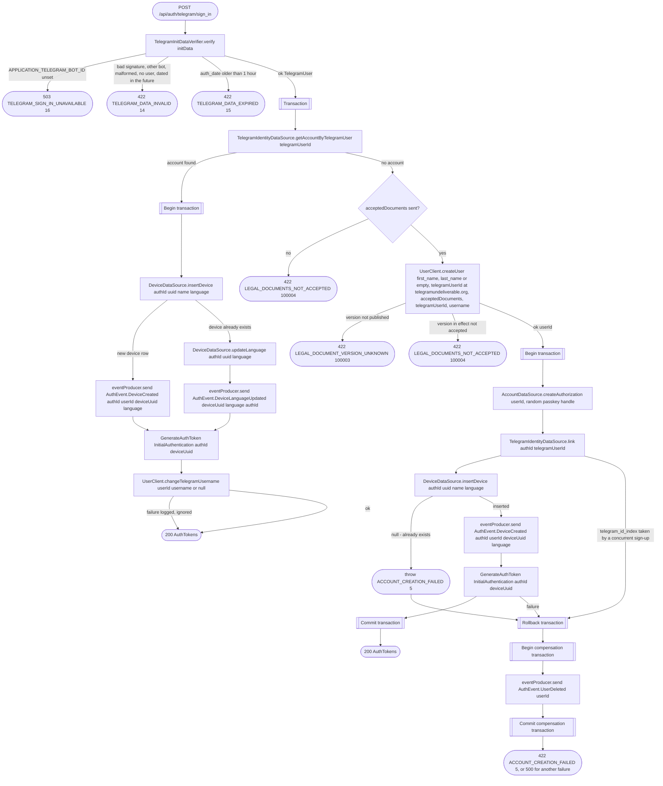

# Sign in with Telegram

`POST /api/auth/telegram/sign_in` → `SignInWithTelegram`

Signs a Telegram Mini App user in with the raw `Telegram.WebApp.initData`. The
data is checked against Telegram's Ed25519 signature for this server's bot
(`APPLICATION_TELEGRAM_BOT_ID`, no bot token needed) and accepted for one hour
after `auth_date`. The account is found by the blind index of the Telegram user
id; an unknown Telegram user gets a new account whose email is the placeholder
`<telegram user id>@telegramundeliverable.org`, which no email is ever sent to.
The Telegram user id also goes to the user service, which stores it encrypted
with the profile and publishes it in `UserEvent.Updated`, so notifications
saves it as the user's Telegram target. The optional `username` of the signed
user object goes along with it, kept only when it is 4 to 32 letters, digits
or underscores. A new account gets it at creation; an existing one has it
synced after every sign-in, since Telegram users can change or remove it, and a
failure there is logged without failing the sign-in.

An existing account ignores `acceptedDocuments`; a client sends them after a
`LEGAL_DOCUMENTS_NOT_ACCEPTED` answer, once the user accepted the documents in
effect. A user deleted with their account, or by dormancy, leaves no
`telegram_identity` row (`ON DELETE CASCADE`), so signing in again creates a new
account.

The username sync is [Store the Telegram username](../user/change-telegram-username-internal.md),
which publishes `UserEvent.Updated` only when the username changed.

**Consumed by:** `AuthEvent.DeviceCreated` → [notifications: mirror the new
device](../notifications/on-device-created.md). `AuthEvent.DeviceLanguageUpdated`
→ [notifications: update the device's locale](../notifications/on-device-language-updated.md).
The compensating `AuthEvent.UserDeleted` fans out to [user](../user/on-user-deleted.md),
[business](../business/on-user-deleted.md), [appointments](../appointments/on-user-deleted.md)
and [notifications](../notifications/on-user-deleted.md), as for [Verify sign-up](sign-up.md).
