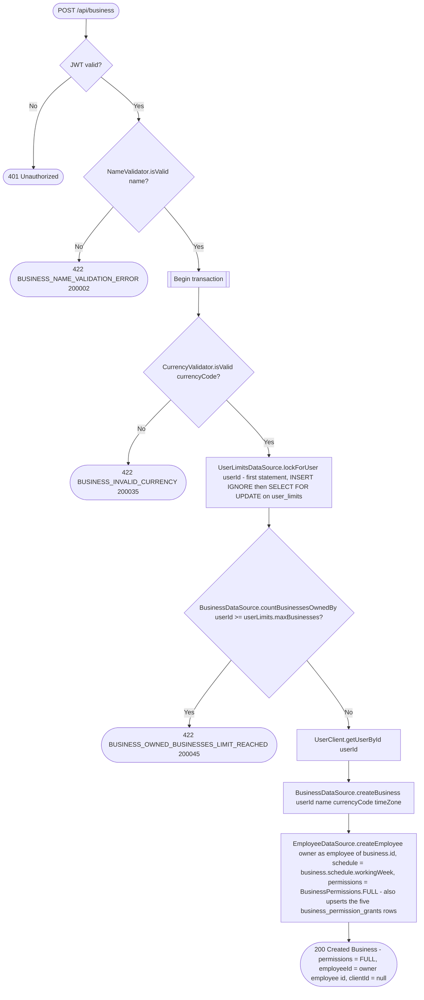

# Create business

`POST /api/business` → `CreateBusiness`

A user can own several businesses, up to their own limit (`max_businesses`,
20 unless an operator stored another value). Only the businesses they own
count (`BusinessDataSource.countBusinessesOwnedBy`); the ones they work at
don't. The count runs after their `user_limits` row is locked, so two
creations by one user can't both take the last place. No route deletes a
business, so the way back under the limit is an operator raising it.

The owner is also inserted as an `EmployeeTable` row for the new business,
snapshotting their name/lastName/phone/email from `UserClient.getUserById`
at creation time. This is what makes `GetUserBusinesses` return owned and
employed-at businesses through the same query, and it is also why
`JoinBusiness` rejects the owner redeeming an invite code for their own
business — `EmployeeDataSource.getEmployeeByUserId` already finds their
owner-employee row and `JoinBusiness.Error.EmployeeExist` fires. The owner
starts on the new business's working week (`business.schedule.workingWeek()`,
Monday to Friday 9 to 17 by default), since bookings check the employee's
schedule as well as the business's.

