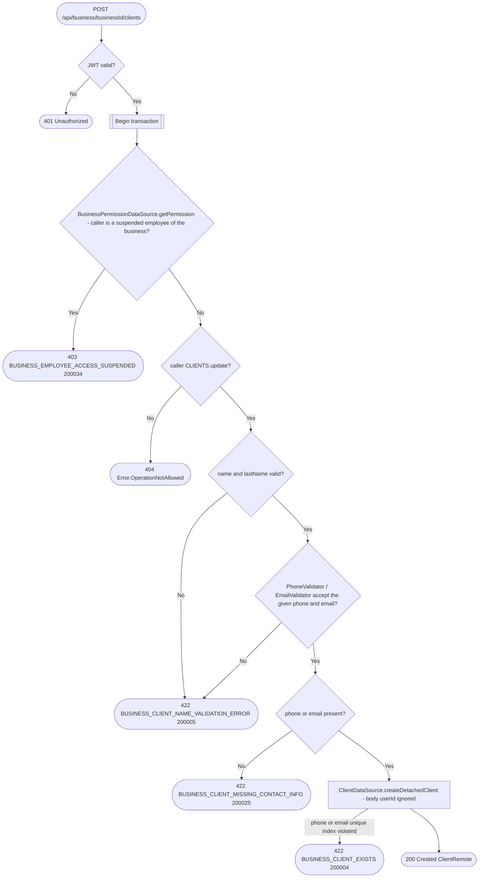

# Create client

`POST /api/business/{businessId}/clients` → `CreateClient`

Always creates a `Detached` client, a contact the business manages. The
body is a `ClientRemote`, whose `userId` is ignored: a business can't link
a client to an app account, since that would let it attach any account
with whatever name and contacts it typed. A client becomes `Integrated`
only through that user's own first booking with the business, which takes
the detached row over ([Get appointment booking
context](get-appointment-booking-context.md)). The business service never
looks the phone or email up in the user service either, so creating a
client reveals nothing about which contacts have an app account. Both `phone`
and `email` are optional, but at least one must be present. Each is unique
per business across every client, detached or integrated, enforced only by
the unique indexes `client_business_id_phone_unique` /
`client_business_id_email_unique`: the insert that violates one is mapped
by `.onConstraintFailure` to `BUSINESS_CLIENT_EXISTS`, so there is no
lookup before it. Many contacts at once go through [Import
clients](import-clients.md).

