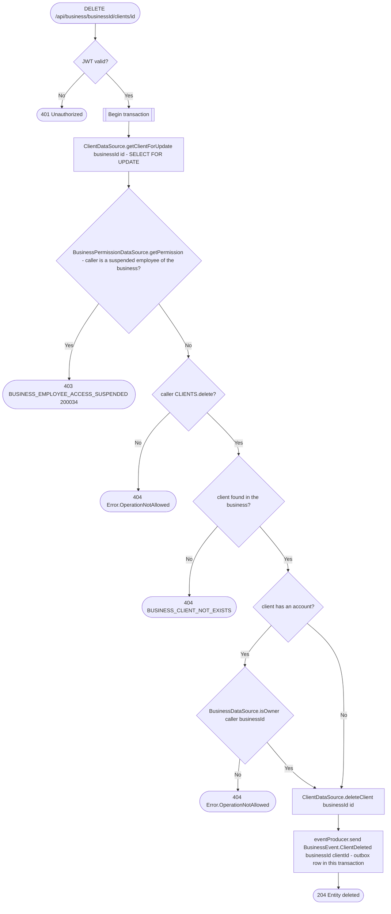

# Delete client

`DELETE /api/business/{businessId}/clients/{id}` → `DeleteClient`

Deletes the business's client row and announces it with
`BusinessEvent.ClientDeleted`, which erases the client from the business's
appointments. Anyone with the `CLIENTS` delete grant may delete a client
without an account. A client with an account (an integrated client, `user_id`
set) can be deleted only by the owner. Their row mirrors a real user, and
deleting it erases that user's booking history at this business. Their
account and their other businesses are untouched.

The client row is locked first (`SELECT … FOR UPDATE`), before the permission
lookup, so a concurrent booking takeover can't turn the row into an
integrated client between the check and the delete. The takeover waits, finds
the row gone and creates a new one instead.

**Consumed by:** `BusinessEvent.ClientDeleted` → [appointments: erase the client](../appointments/on-client-deleted.md).
