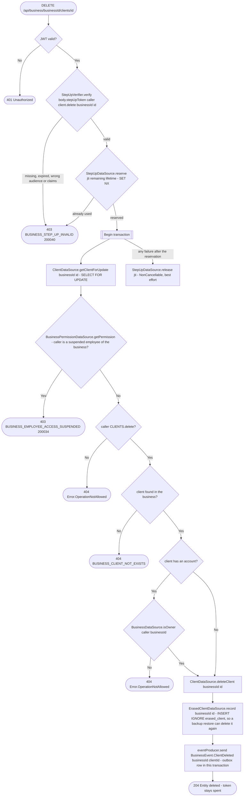

# Delete client

`DELETE /api/business/{businessId}/clients/{id}` → `DeleteClient`

Deletes the business's client row and announces it with
`BusinessEvent.ClientDeleted`, which erases the client from the business's
appointments. Anyone with the `CLIENTS` delete grant may delete a client
without an account. A client with an account (an integrated client, `user_id`
set) can be deleted only by the owner. Their row mirrors a real user, and
deleting it erases that user's booking history at this business. Their
account and their other businesses are untouched.

The deletion must be confirmed with a passkey: the request body carries a
step-up token from [Confirm a sensitive action with a
passkey](../authorization/step-up.md), issued for this caller, the action
`client.delete`, this business and this client. `StepUpVerifier` checks its
signature (auth's keys, step-up audience), expiry and claims, then
`StepUpDataSource.reserve` spends its `jti` once (Valkey `SET NX` on
`step_up:<jti>` until the token expires). If the deletion then fails for any
reason, the reservation is released, so a rejected call doesn't burn the
token. An app that sends no body gets the same 403, so it knows to ask for
the passkey.

The client row is locked first (`SELECT … FOR UPDATE`), before the permission
lookup, so a concurrent booking takeover can't turn the row into an
integrated client between the check and the delete. The takeover waits, finds
the row gone and creates a new one instead.

**Consumed by:** `BusinessEvent.ClientDeleted` → [appointments: erase the client](../appointments/on-client-deleted.md).
