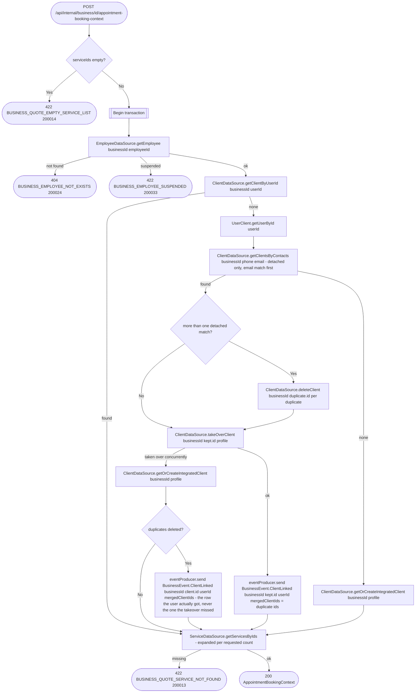

# Get appointment booking context (internal)

`POST /api/internal/business/{id}/appointment-booking-context` → `GetAppointmentBookingContext`

Called by appointments when a user books, to resolve the employee, the
services and the user's client record from the business service's own
data. On the user's first booking with the business it attaches them as an
integrated client. A detached client is only a placeholder for a person
until they use the app, so before inserting a new row it looks for
detached clients of the business holding the user's email or phone
(`getClientsByContacts`) and takes one over instead: the row keeps its
`id` (which appointments store as `client_id`) and `description`, gets the
user's `user_id`, and its name, last name, email and phone are replaced by
the profile's (the stored phone is kept when the profile has none). The
row holding the email wins; any other matching detached row is the same
person twice, so it is deleted. One `BusinessEvent.ClientLinked` then names
the kept row, its new owner and the deleted duplicates, so appointments
moves the duplicates' history onto the kept row and records the account on
all of it. Integrated rows of other users are never taken over.

Phone and email are not verified yet, so whoever puts a phone or email in
their profile takes over the matching contact, notes included.

**Consumed by:** `BusinessEvent.ClientLinked` → [appointments: move the duplicates' history and give the client's appointments the account](../appointments/on-client-linked.md).
