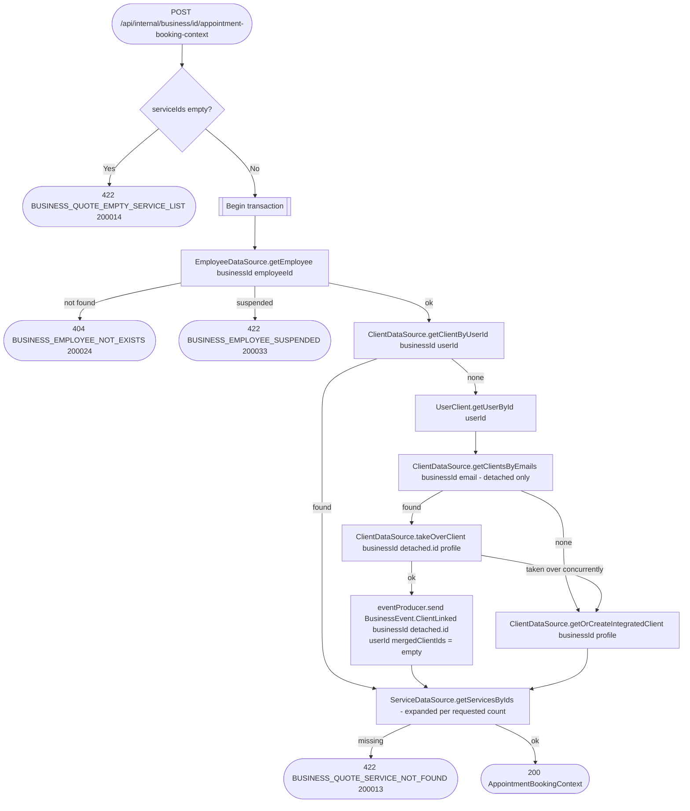

# Get appointment booking context (internal)

`POST /api/internal/business/{id}/appointment-booking-context` → `GetAppointmentBookingContext`

Called by appointments when a user books, to resolve the employee, the
services and the user's client record from the business service's own
data. An employee booking an existing client uses [Get staff booking
context](get-staff-booking-context.md) instead. On the user's first booking with the business it attaches them as an
integrated client. A detached client is only a placeholder for a person
until they use the app, so before inserting a new row it looks for the
detached client of the business holding the user's email
(`getClientsByEmails`; the email is unique per business, so there is at
most one) and takes it over instead: the row keeps its `id` (which
appointments store as `client_id`) and `description`, gets the user's
`user_id`, and its name, last name, email and phone are replaced by the
profile's (the stored phone is kept when the profile has none). One
`BusinessEvent.ClientLinked` with no merged ids then names the row and its
new owner, so appointments records the account on its history. Integrated
rows of other users are never taken over.

Only the email is matched, because only the email is verified: sign-up
proves the address with a code, so the takeover goes to the person who
owns it. A phone is never verified and is not unique per business, so a
detached row holding only the user's phone stays as it is and the user gets
a new row.

**Consumed by:** `BusinessEvent.ClientLinked` → [appointments: give the client's appointments the account](../appointments/on-client-linked.md).
