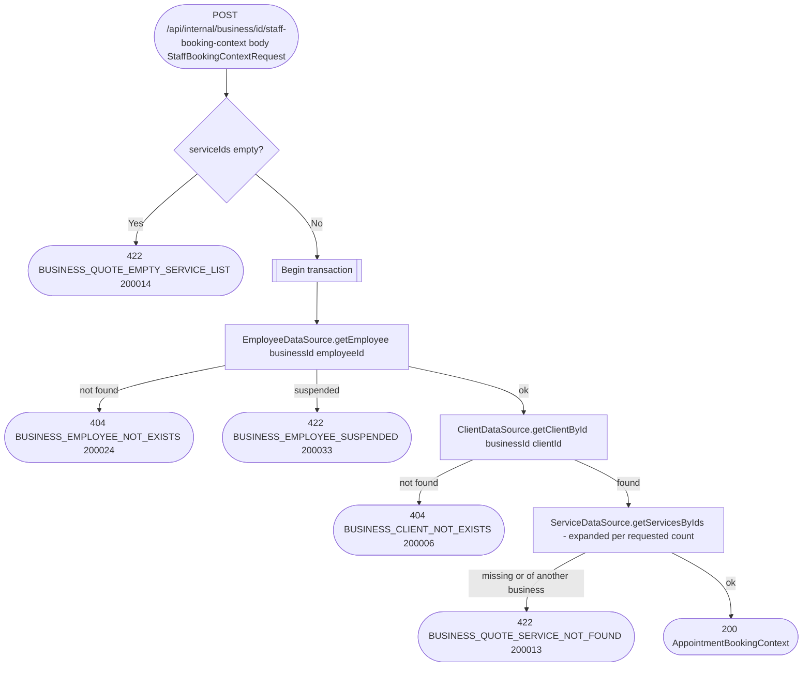

# Get staff booking context (internal)

`POST /api/internal/business/{id}/staff-booking-context` → `GetStaffBookingContext`

Called by appointments when an employee books an existing client of the
business ([Create instant appointment](../appointments/create-appointment-instant.md)),
to resolve the employee, the client and the services from the business
service's own data. Every field of the body (`StaffBookingContextRequest`:
employee id, client id, service ids) is required.

It only reads. The client is the business's own row (`getClientById`,
scoped to the business), so a client of another business, or one that no
longer exists, is 404 `BUSINESS_CLIENT_NOT_EXISTS`. Nothing is created,
taken over or linked, and no event is sent; a user booking for themselves
goes through [Get appointment booking
context](get-appointment-booking-context.md), which can do all of that.

Who may book into the employee's schedule is decided by appointments, from
its own permission grants, not here.

